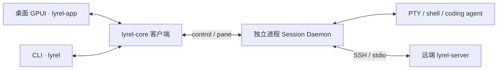

# 仓库工作指南

## 项目概览

lyrel 基于 [l0ng-ai](https://github.com/l0ng-ai) 的 Apache-2.0 许可终端源码独立开发，是 Rust 原生终端工作台：GPUI GPU 渲染、持久化 shell 会话、SSH、coding agent、Git/文件编辑，面向桌面本地开发与桌面远程开发。保留原始版权、Apache-2.0 许可证及真实第三方资源来源。

产品与根包为 `lyrel`，GUI 为 `lyrel-app`，CLI crate 为 `lyrel-cli`、命令为 `lyrel`，共享核心为 `lyrel-core`，server 为 `lyrel-server`，updater 为 `lyrel-updater`，统一从 `0.1.0` 独立编号，仅提供 stable。项目入口为 `https://github.com/dlivxpr/lyrel`；`.github-disable/` 保持禁用。独立命令、`LYREL_*` 环境变量、数据与凭据命名空间不自动读取、迁移或接管其他产品的实例；应用更名不重置 IPC 协议版本。

## 架构与数据流

- GUI 可用自身二进制的 `--daemon` 模式拉起守护进程；`lyrel-server` 是复用同一核心的 headless 入口。会话生命周期不依赖窗口是否打开。
- `src/daemon.rs` 重导出 `lyrel_core::daemon`；`src/core/mod.rs` 重导出共享核心并补充 GUI 适配。修改共享逻辑应定位到 `crates/lyrel-core/`，不要在 GUI 层复制一套。
- daemon 持有机器／工作区／标签页／pane 树并持久化；`src/ui/machine_mirror.rs` 是窗口侧镜像。保留拉取期间本地写操作的重放逻辑，避免旧快照覆盖新操作。
- `lyrel-core` 保持无 GPUI 依赖；系统凭据存储留在 GUI。`lyrel-server` 唯一生产依赖是 `lyrel-core`，保持远端 server 的依赖精简。

## 关键目录

| 路径 | 修改范围 |
| --- | --- |
| `src/ui/` | 工作台、窗口、pane 布局、Git/文件/编辑器、设置与本地化 |
| `src/terminal/` | 终端视图、输入、补全、搜索与输出渲染 |
| `src/core/` | 共享 core 的 GUI 包装、系统集成、凭据与窗口状态 |
| `crates/lyrel-core/` | 无 GUI 的领域模型、Host 抽象、会话 daemon、PTY、SSH 与 IPC |
| `crates/lyrel-server/`、`crates/lyrel-cli/` | headless 服务端与面向用户／agent 的 CLI |
| `scripts/`、`.github-disable/scripts/` | 基准、补全数据转换，以及禁用的 CI/打包/平台断言材料 |
| `docs/`、`assets/` | Mintlify 文档、运行资源／补全数据 |

## 开发命令

以下命令在仓库根目录执行；`cargo dev` 使用 `.lyrel-dev` 隔离真实用户配置。

| 目的 | 命令 |
| --- | --- |
| 启动桌面开发实例（Windows/macOS） | `cargo dev` |
| 桌面 Debug 构建／Release 构建 | `cargo build --locked` / `cargo build --release --locked` |
| 查看 CLI 用法 | `cargo run --locked -p lyrel-cli -- --help` |
| 准备官方 ConPTY（Windows 首次构建或 `.conpty/` 失效前运行一次） | `pwsh scripts/prepare-conpty.ps1` |
| 启动隔离的 headless daemon | `cargo run --locked -p lyrel-server -- --daemon --config-dir .lyrel-dev` |
| 桌面平台默认成员测试，与 CI 范围一致 | `cargo test --locked` |
| 桌面平台根 workspace 全成员测试 | `cargo test --workspace --locked` |
| 桌面 updater 专项测试（Windows/macOS） | `cargo test --locked --features updater --bin lyrel-updater` |
| 格式检查／写回 | `cargo fmt --check` / `cargo fmt` |
| Host 架构边界检查，需 Bash 与 LF 脚本行尾 | `bash .github-disable/scripts/check-host-boundary.sh` |
| 补充 lint，保留的 CI 材料未运行此项 | `cargo clippy --workspace --all-targets --locked` |

Windows/macOS 的默认 `build`/`test` 覆盖全部四个 workspace 成员。Linux 仅保留 core/server/CLI：使用 `cargo build --locked --workspace --exclude lyrel --all-features` 与 `cargo test --locked --workspace --exclude lyrel --all-features`；根桌面包会明确拒绝 Linux。Linux 完整 features 需 MIT Kerberos 开发依赖及 `LIBGSSAPI_IMPL=mit`，不需要桌面图形库。手机访问不属于产品范围，不预留移动网关或关闭的兼容实现。

Windows 下此 Bash 检查需 LF 工作树：CRLF 脚本会报 `$'\r': command not found`／`invalid option name`，CRLF Rust 源文件还会使测试边界匹配失效并产生误报。当前 `.gitattributes` 未为 `.sh` 固定行尾；先排除行尾问题，不通过扩大 allowlist 掩盖。

## 书写语言

- `AGENTS.md` 使用简体中文。
- GitHub issue 的标题、正文与评论使用英文。
- Git 提交信息使用英文。
- `docs/` 下的文档使用简体中文；代码、命令、路径与 API 名保留原文。

## 代码约定与常用模式

- Rust 使用默认 rustfmt；函数／模块为 `snake_case`，类型为 `UpperCamelCase`。共享 Clippy 配置禁止 `dbg!` 和 `todo!`，允许 `type_complexity`。
- 工作区路径可能属于远端。文件、Git、目录监视等操作通过 `Host`／`SharedHost` 注入，GUI 经 `src/ui/host_ops.rs` 的 `HostOps` 在线程池执行；不要在 UI 中直接用本地文件系统解析远端路径。
- GPUI 使用 `Entity` 保存视图状态、`Global` 保存应用级状态。异步沿用 `cx.spawn`、`background_executor`，完成后通过实体／context 更新 UI；Host 阻塞调用不能放在 UI 线程。
- daemon 使用 std 线程与 channel，SSH 引擎有自己的 Tokio runtime；不要将 GUI 与 daemon 视为同一个异步执行环境。
- CLI 的依赖替换点是 `crates/lyrel-cli/src/backend.rs` 的 `Backend` trait；沿用真实 backend 与测试替身的分层。
- Host/文件操作返回 `io::Result`；二进制边界使用 `anyhow` 和错误上下文。GUI 可见失败沿用 `HostOps::run_or_notify`／error notification，保留 CLI 的错误链与子进程退出码。
- 修改终端输出热路径时保留隐藏 pane 的通知门控，避免不可见输出触发整窗重绘，见 `src/terminal/view.rs`。
- 修改 UI 先读 `docs/design-system.md`；颜色取自 `src/ui/presets.rs` 与 `src/ui/theme.rs` 的语义角色。新增文案通过 `src/ui/i18n/` 的 `L10nKey`，同步 `en`、`zh-CN` 翻译；`system` 仅为配置选择模式，不是第三种翻译语言。语言解析规则见 `docs/customization/settings.mdx`，不得用 PTY locale 代替 OS 界面语言。
- 修改 IPC 前读 `crates/lyrel-core/src/daemon/control.rs` 与 `crates/lyrel-core/src/daemon/protocol.rs`。增删 control 消息变体需提升 `CONTROL_VERSION`；可忽略字段按 feature 协商。pane 协议另有版本，不能混用。

## 重要文件

- `src/main.rs`：GUI／daemon／agent-hook 角色分发、应用启动与全局注册。
- `src/ui/app.rs`、`src/terminal/view.rs`：工作台编排与终端主视图；文件很大，按符号或行为定位范围阅读。
- `crates/lyrel-cli/src/cli.rs`：用户可见命令和参数契约。
- `crates/lyrel-core/src/core/config.rs`：共享配置、目录解析和进程级覆盖；`src/core/config.rs` 是 GPUI 包装与测试写盘守卫。
- `Cargo.toml`、`Cargo.lock`：workspace、统一版本、features 与正式锁定依赖；`.cargo/config.toml`：开发别名与 Windows 编译参数。
- `build.rs`：Windows 图标资源；`crates/lyrel-core/build.rs`：GUI、server、CLI 与测试程序共用的已核验 ConPTY 暂存。
- `docs/docs.json`：文档导航；源码构建依赖见 `docs/getting-started/installation.mdx`。修改补全生成流程读 `scripts/fig-convert/README.md`，性能验证读 `scripts/bench/README.md`，后者依赖 macOS/zsh。

## 运行时与工具偏好

- Rust edition 2024，保留的 CI 材料使用 stable；仓库未固定具体 toolchain/MSRV。使用 Cargo 与现有 lockfile，不把本机 Rust 版本写成项目要求。
- 第三方 Rust 依赖只使用正式 registry 发布包，不引入 Git、自定义第三方 path 或 `[patch]`；自有 workspace path 保留。不通过复制第三方内部实现、修改下载源码或构建时补丁绕过。GUI 经 `gpui-kit` 使用 `gpui-pre` 路线，GUI 与 CLI 共用正式 `rio-vt`；修改依赖前核对 manifest、锁文件与 `docs/getting-started/installation.mdx`，不启用 `gpui-fast`。
- Git CLI 仍用于产品的 Git 工作流，不再是 Cargo Git 依赖的拉取前提。Windows MSVC 已设 `+crt-static`，不要用 `RUSTFLAGS` 意外覆盖；ConPTY 先运行 `pwsh scripts/prepare-conpty.ps1`，共享核心的构建脚本只消费准备结果。Linux headless 的 GSSAPI 依赖与 `LIBGSSAPI_IMPL=mit` 见 `.github-disable/workflows/ci.yml`；Windows/macOS 连接 Linux 的 SSH/SFTP、Host/PTY 与 WSL 接线不可因桌面退役删除。
- 默认配置目录为 Unix 的 `~/.config/lyrel`、Windows 的 `%APPDATA%\lyrel`；覆盖顺序为 `--config-dir`、`LYREL_CONFIG_DIR`、便携模式、默认目录。调试与测试使用隔离目录，避免影响已安装实例。产品注入的 `TERM_PROGRAM` 值为 `lyrel`；标准环境变量键保持原样。

## 测试与质量保障

- 单元测试多为内联 `#[cfg(test)] mod tests`；GUI 用 `#[gpui_kit::test]`／`TestAppContext`，异步集成测试用 `#[tokio::test]`。CLI E2E 是 `harness = false` 的自定义 runner。
- 按改动选择测试，例如 `cargo test --locked -p lyrel-core`、`cargo test --locked -p lyrel-cli --test cli_e2e`；Host 契约复用 `crates/lyrel-core/src/host/conformance.rs` 的本地／stdio 共享套件。
- 集成测试从 `env!("CARGO_BIN_EXE_lyrel-server")` 等获取真实二进制。沿用 `tempfile::TempDir`、隔离配置／socket、子进程退出清理；GUI 测试写配置前调用 `crate::core::config::pin_test_config_dir()`。
- Pi 桥契约测试需要当前平台的 Node 22.19+ 位于 `PATH`；Linux 测试不能以 Windows 的 `node.exe` 代替。缺少运行时是验证前提失败，不能跳过用例后宣称完整套件通过。
- 很多 server 集成测试受 `cfg(unix)` 限制；Windows 绿灯不能替代 Unix 验证。联网、真实 SSH/LSP 的 ignored 用例仅在具备前提时显式运行；检查外部工具缺失导致的跳过。
- 保留的 CI 材料覆盖 rustfmt、Host 边界、Windows/macOS 桌面与 headless 构建／测试，以及 Linux core/server/CLI 的完整 features 验证；桌面 updater 仅在 Windows/macOS 测试。测试执行设置外部超时，普通套件为 20 分钟、updater 为 10 分钟。这些材料位于 `.github-disable/`，不代表 Actions 已启用。
- 仓库未配置覆盖率工具或百分比阈值。
- 行为变更除相关测试外还需实际运行受影响路径；UI 修改按 `docs/design-system.md` 做实际界面验收。交付时区分已运行、跳过和未验证项。

## Agent skills

CLI 操作使用 `skills/lyrel/SKILL.md`；委派其他 coding agent 前，按该 skill 读取 `references/delegation.md`。

### 子智能体角色

在 oh-my-pi 中需要委派子智能体时，调研类任务使用 `smol` 角色，代码类任务使用 `task` 角色。

### 工单跟踪

工单与规格使用 GitHub Issues；创建、读取或更新工单前，阅读 `docs/agents/issue-tracker.md`。

### 分诊标签

使用五种默认 triage 标签；分诊或设置工单状态前，阅读 `docs/agents/triage-labels.md`。

### 领域文档

领域文档为单上下文布局，产品术语与工程约束直接维护在相关正式文档中；探索代码前，阅读 `docs/agents/domain.md`。仅在用户明确要求时创建独立规格或工单，不自动生成文档目录。
