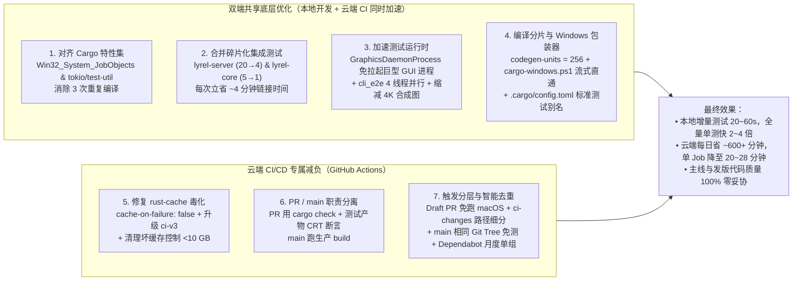
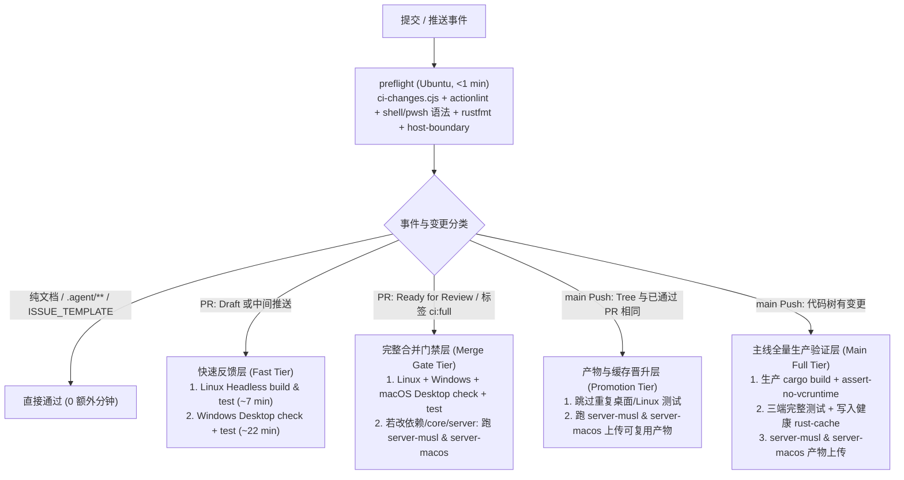

# Lyrel 本地测试与 GitHub CI/CD 负载分析报告及一体化优化方案

- **日期**：2026-11-17
- **状态**：方案已确认（含本地测试加速与 GitHub CI/CD 减负一体化设计）
- **适用范围**：
  - 本地开发与测试链路：`Cargo.toml`、`.cargo/config.toml`、`scripts/cargo-windows.ps1`、`crates/lyrel-core/`、`crates/lyrel-server/tests/`、`crates/lyrel-cli/tests/cli_e2e.rs`、`src/terminal/graphics_pty_consumer_support.rs`
  - GitHub CI/CD 流水线：`.github/workflows/ci.yml`、`.github/workflows/release-build.yml`、`.github/scripts/ci-changes.cjs`、`.github/dependabot.yml`
- **核心原则**：**一次性打通本地测试提速与云端 CI/CD 减负**。在不降低 `main` 主线与正式发行包最终代码质量、安全门禁和平台覆盖率的前提下，消除重复编译、碎片化链接与低效进程拉起，让本地增量测试进入“秒级/分钟级”，将云端 CI 每日消耗与排队时间削减 50% 以上。

---

## 0. 已确认的设计决策

1. **PR 分层验证（已确认同意）**：Draft PR 或高频中间推送仅运行快速验证（`preflight` + Linux headless + Windows 验证），将昂贵且并发槽位稀缺的 macOS 桌面完整矩阵与 `server-macos` / `server-musl` 延后至 PR 标记为 Ready for Review（或添加 `ci:full` 标签）及 `main` 分支合入时执行。
2. **修复并清理污染的 Actions 缓存（已确认同意）**：关闭编译失败时的盲目缓存写回（`cache-on-failure: false`），清理 `11-16` 失败运行写入的 3 个残缺缓存条目及过期的 `release-v2-*` 缓存，将仓库缓存总容量控制在 GitHub 10 GB 免费上限以内。
3. **生产图编译按分支职责收敛（已确认同意）**：PR 阶段使用 `cargo check` 验证无测试特性的生产依赖图（测试编译步骤本身已完整编译并链接所有库与二进制，并在 PR 上对测试编译产物执行 `assert-no-vcruntime.ps1`），将耗时的生产全量 `cargo build` 集中在 `main` push 与 `release-validation` 阶段执行，同时移除 `main` 上冗余的 `cargo check`。
4. **本地测试与 CI/CD 一体化协同优化（已确认同意）**：所有针对 Cargo 特性集对齐、集成测试二进制合并、`cli_e2e` 并行化、`GraphicsDaemonProcess` 轻量化、`cargo-windows.ps1` 流式改造及增量编译分片的优化，**同时作用于本地开发与 GitHub CI/CD**，一份改动双端受益。

---

## 第一部分：测试与 CI/CD 历史负载分析报告

### 1.1 数据采集口径与基线

本报告通过只读 `gh run list` 与 `gh api` 接口拉取了仓库自 **2026-10-20 至 2026-11-17** 的全部 **290 次 Workflow 运行**（共 **2,402 个去重后 Job**；其中 1 次早期 Release 运行因 GitHub API 返回 HTTP 502 未计入，不影响近期统计），并结合本地源码结构与测试框架进行了静态与日志级取证。

- **重跑去重**：使用 GitHub "Re-run failed jobs" 时，已成功的 Job 会以相同的 `started_at` / `completed_at` 复制到新 attempt。统计前已按 `name + started_at + completed_at` 严格去重，只统计真实消耗了 runner 算力的执行。
- **计费分钟口径**：每个非跳过 Job 的耗时按 `ceil((completed_at - started_at) / 60s)` 向上取整至整分钟，与 GitHub Actions 计费规则一致。
- **估算基线选择**：采用**最近 7 天（2026-11-10 ~ 2026-11-17，共 77 次运行、642 个去重 Job）**作为节省分钟数的估算基线。原因在于近期随着新功能（#236 Markdown Editor、#247/#302 终端图形与状态、#279/#301 文件预览与格式编辑）合入，单次桌面 Job 耗时已显著高于 28 天均值，7 天窗口更能反映当前真实负载。

| 统计口径 | Linux (min/day) | Windows (min/day) | macOS (min/day) | 合计 (min/day) |
| --- | ---: | ---: | ---: | ---: |
| **最近 7 天实际 Runner 分钟/天（估算基线）** | **160.9** | **468.9** | **552.9** | **1,182.6** |
| 最近 28 天实际 Runner 分钟/天 | 137.7 | 289.1 | 322.5 | 749.3 |
| 最近 7 天标准计费乘数加权（Linux×1, Win×2, macOS×10） | 160.9 | 937.7 | 5,528.6 | **6,627.1** |
| 最近 28 天标准计费乘数加权 | 137.7 | 578.2 | 3,225.0 | 3,940.9 |

> [!IMPORTANT]
> 当前仓库为 **PUBLIC** 仓库，使用 GitHub-hosted 标准 runner 虽然不产生账单费用，但受限于账户级并发槽位（尤其是 macOS 最大并发限制）。过去 28 天内，**macOS Job 排队等待（created → started）p90 达 22.3 分钟，Windows 排队 p90 达 27.2 分钟**；单次成功 CI 的端到端 Wall-clock 时间 **p50 为 26.1 分钟，p90 高达 77.9 分钟**。削减 CI 分钟数直接等价于消除排队拥堵与缩短开发反馈周期。

---

### 1.2 全局负载分布

#### （1）按工作流与触发事件分布（最近 7 天 vs 28 天）

| Workflow | 触发事件 | 7 天 Job 数 | 7 天总分钟 | **7 天日均 (min/day)** | 7 天加权日均 | 28 天日均 (min/day) |
| --- | --- | ---: | ---: | ---: | ---: | ---: |
| `CI` | `pull_request` | 313 | 4,431 | **633.0 (53.5%)** | 3,577.0 | 444.7 |
| `CI` | `push` (`main`) | 198 | 2,671 | **381.6 (32.3%)** | 2,155.7 | 228.2 |
| `CI` | `workflow_dispatch` | 45 | 542 | **77.4 (6.5%)** | 437.3 | 23.0 |
| `Release` | `push` (`v*`) | 52 | 358 | **51.1 (4.3%)** | 257.7 | 35.9 |
| `Release` | `workflow_dispatch` | 32 | 269 | **38.4 (3.2%)** | 198.4 | 15.9 |
| `Dependabot Updates` | `dynamic` | 2 | 7 | **1.0 (0.1%)** | 1.0 | 1.5（含触发的 PR CI 则达 **69.6**） |
| **合计** | — | **642** | **8,278** | **1,182.6 (100%)** | **6,627.1** | **749.3** |

#### （2）按具体 Job 名称分布（最近 7 天 Top 12）

| 排名 | Workflow \| Job 名称 | 7 天运行次数 | 7 天日均 (min/day) | 占比 | 单次耗时 p50 (min) | 单次耗时 p90 (min) |
| :-: | --- | ---: | ---: | ---: | ---: | ---: |
| 1 | `CI \| build & test (aarch64-apple-darwin)` | 61 | **421.4** | 35.6% | 49.3 | 70.1 |
| 2 | `CI \| build & test (x86_64-pc-windows-msvc)` | 55 | **384.1** | 32.5% | 42.9 | 78.4 |
| 3 | `CI \| build & test (x86_64-unknown-linux-gnu)` | 52 | **55.3** | 4.7% | 7.0 | 8.2 |
| 4 | `CI \| lyrel-server macOS (aarch64-apple-darwin)` | 55 | **49.4** | 4.2% | 5.1 | 8.1 |
| 5 | `CI \| lyrel-server musl (aarch64-unknown-linux-musl)` | 52 | **37.0** | 3.1% | 4.4 | 5.7 |
| 6 | `CI \| release-validation / build (aarch64-apple-darwin)` | 8 | **34.1** | 2.9% | 27.8 | 36.2 |
| 7 | `CI \| lyrel-server musl (x86_64-unknown-linux-musl)` | 52 | **33.7** | 2.9% | 4.1 | 4.8 |
| 8 | `CI \| release-validation / build (x86_64-pc-windows-msvc)` | 8 | **32.7** | 2.8% | 28.4 | 37.4 |
| 9 | `Release \| production / build (aarch64-apple-darwin)` | 8 | **31.3** | 2.6% | 31.4 | 34.3 |
| 10 | `Release \| production / build (x86_64-pc-windows-msvc)` | 8 | **30.0** | 2.5% | 32.0 | 36.0 |
| 11 | `CI \| release-validation / server-macos` | 9 | **10.6** | 0.9% | 6.8 | 15.3 |
| 12 | `CI \| preflight` | 65 | **9.4** | 0.8% | 0.6 | 0.8 |

#### （3）按执行结论与重跑分布（最近 7 天）

| 结论类型 | Job 数 | 7 天日均 (min/day) | 占比 | 说明 |
| --- | ---: | ---: | ---: | --- |
| `success` | 453 | 829.0 | 70.1% | 正常完成的构建与测试 |
| `failure` | 63 | **284.6** | **24.1%** | 绝大多数发生在耗时 40~50 分钟编译后的测试执行阶段（macOS 158.0/天，Windows 117.7/天） |
| `cancelled` | 19 | **69.0** | **5.8%** | PR 连续推送取消前序运行（p50 已跑 15.3 分钟，p90 已跑 56.4 分钟） |
| 其中：`attempt > 1`（重跑） | 20 | **45.1** | 3.8% | 因偶发超时/端口或跨 daemon 竞争触发的手动 Re-run |

---

### 1.3 五周耗时劣化趋势与代码/测试规模画像

#### （1）自然周耗时劣化趋势（`CI | build & test` p50 分钟数）

| 周起始日 | 平台 | 样本数 | **Job p50** | Job p90 | `check` | `build` | `lib --no-run` | `all --no-run` | `test` 执行 | `native_md` 编译 | `native` 执行 |
| --- | --- | ---: | ---: | ---: | ---: | ---: | ---: | ---: | ---: | ---: | ---: |
| 2026-10-19 | macOS | 51 | **8.0** | 10.4 | — | 1.5 | — | — | 4.8 | — | — |
| 2026-10-26 | macOS | 43 | **20.1** | 26.0 | — | 1.9 | — | — | 10.5 | — | — |
| 2026-11-02 | macOS | 49 | **21.7** | 46.5 | — | 2.3 | — | — | 12.8 | — | — |
| 2026-11-09 | macOS | 61 | **46.8** | 61.2 | 1.1 | 5.8 | — | 16.4 | 14.1 | 3.0 | 1.1 |
| **2026-11-16** | **macOS** | **17** | **66.9** | **75.6** | **3.3** | **16.4** | **19.4** | **4.4** | **18.0** | **3.9** | **2.0** |
| 2026-10-19 | Windows | 50 | **11.5** | 17.1 | — | 2.6 | — | — | 6.5 | — | — |
| 2026-10-26 | Windows | 43 | **14.9** | 24.6 | — | 3.0 | — | — | 7.8 | — | — |
| 2026-11-02 | Windows | 48 | **23.3** | 43.4 | — | 3.7 | — | — | 8.5 | — | — |
| 2026-11-09 | Windows | 58 | **39.0** | 76.8 | 1.7 | 6.4 | — | 12.7 | 8.6 | 3.6 | 1.3 |
| **2026-11-16** | **Windows** | **14** | **61.5** | **78.9** | **2.9** | **17.1** | **16.5** | **4.2** | **9.3** | **8.4** | **1.6** |
| 2026-10-19 → 11-16 | Linux | 41→13 | **3.0 → 8.1** | 3.6 → 8.5 | — | 0.4 → 2.2 | — | — | 1.8 → 4.3 | — | — |

#### （2）当前各 Crate 代码与测试规模分布

| 目录 / Crate | Rust 源文件数 | 代码行数 (LOC) | `#[test]` / `#[gpui_kit::test]` / `#[tokio::test]` 数量 | 独立 `tests/*.rs` 集成测试二进制数 |
| --- | ---: | ---: | ---: | ---: |
| `src/`（根包 `lyrel`） | 512 | **356,209** | **3,533** | 2 (`native_markdown`, `native_terminal`) |
| `crates/lyrel-core` | 255 | **152,994** | **2,211** | **5** (`skills*`, `statistics_pricing`) |
| `crates/lyrel-markdown-editor` | 24 | 25,303 | 179 | 1 (`foundation`) |
| `crates/lyrel-server` | 23 | 14,913 | 144 | **20** (`client_lib`, `handoff`, `program_status` 等) |
| `crates/lyrel-cli` | 54 | 12,744 | 191 | 1 (`cli_e2e`，含 28 个 E2E 用例) |
| `crates/lyrel-pdf` | 5 | 3,150 | 30 | 0 |
| `crates/lyrel-epub` | 10 | 3,087 | 18 | 0 |
| `crates/lyrel-text` | 1 | 1,276 | 37 | 0 |
| **合计** | **884** | **569,676** | **6,343** | **29** |

---

### 1.4 六大核心瓶颈的根因定位（同时涵盖本地测试与云端 CI）

#### 根因 1（云端 CI）：`Swatinem/rust-cache` 被一次失败的 `main` 运行“毒化” + 10.72 GB 容量超限

1. **取证事实**：通过 `gh api repos/dlivxpr/lyrel/actions/caches` 检查当前活跃的 11 个缓存条目，当前 `main` 分支上 3 个核心 CI 缓存的创建时间如下：
   - `v0-rust-ci-v2-aarch64-apple-darwin-Darwin-arm64-d8798992-b063e3cd`（1,689 MB）：创建于 `2026-11-16T07:07:44Z`
   - `v0-rust-ci-v2-x86_64-pc-windows-msvc-Windows_NT-x64-882ed3c3-13bddc6a`（1,722 MB）：创建于 `2026-11-16T07:09:15Z`
   - `v0-rust-ci-v2-x86_64-unknown-linux-gnu-Linux-x64-bc6b78d9-b063e3cd`（672 MB）：创建于 `2026-11-16T07:05:04Z`
2. **形成机理**：上述三个时间戳精确对应 `main` push 运行 `43821030240`（`chore(release): bump version to 0.3.5`）中三个 Job 的 `Post Run Swatinem/rust-cache@v2` 步骤完成时刻。在该次运行中，由于修改了 `Cargo.toml` 版本号但未同步 `Cargo.lock`：
   - `Check desktop and headless` / `Build Linux headless` 在 **1~3 秒内即因 `--locked` 报错退出**，未编译任何新产物；
   - 但由于 `.github/workflows/ci.yml` 配置了 `cache-on-failure: true`，`rust-cache` 将 prefix fallback 恢复出来的旧残缺缓存直接以新哈希 key（`-b063e3cd` / `-13bddc6a`）保存到了 `refs/heads/main`。
3. **持续恶果**：随后提交 `ac106364`（`sync Cargo.lock to 0.3.5`）虽然修复了 lockfile，但因为 `rust-cache` 的缓存 key 对 `Cargo.lock` 内容取哈希时排除工作区自身包版本，后续**每一次** `main` push 和 PR 运行在 Restore 阶段都命中 `Restored from cache key "...-13bddc6a" full match: true`。而 GitHub Actions 缓存机制在 `full match: true` 时**永远跳过 Post 阶段的重新上传**！
4. **日志实证**：在 `full match: true` 的 `main` 运行（如 `133344896837` Windows 与 `133344896814` macOS）中，`Build desktop and headless` 步骤仍然每次从头编译 **237 个 crate（Windows，耗时 17.1~23.1 分钟）** 和 **249 个 crate（macOS，耗时 17.2~21.3 分钟）**。
5. **容量超限**：当前仓库活跃缓存总体积为 **10.72 GB（10,720,133,687 bytes）**，已超过 GitHub 10 GB 上限（其中 5 个 `release-v2-*` 缓存占用了 4.76 GB），随时触发后台 LRU 驱逐。

#### 根因 2（本地 + 云端共性）：Feature 集漂移导致底层依赖与 GUI 栈在切换命令或单次 CI 中重复编译 3 遍

对比 Windows 构建日志（`133344896837`）与 macOS 构建日志（`133344896814`）以及本地开发在不同 `cargo` 命令间切换时的行为，存在 **3 套互不兼容的 Feature 组合**：

| 场景 / 阶段 | 执行命令 | `windows-sys` 特性 | `tokio` 特性 | `gpui-kit` 特性 | 本地与 CI 触发的重编代价 |
| --- | --- | --- | --- | --- | --- |
| **组合 1**（本地 `cargo dev` / `cargo build` 或 CI Pass 1） | `cargo build --locked --features updater` | 仅 `[dependencies]`（**无** `Win32_System_JobObjects`） | 仅 `[dependencies]`（**无** `test-util`） | `gpui-fast`, `tree-sitter-languages`（**无** `test-support`） | 编译完整生产依赖图（237~249 个 crate，**17~23 min**） |
| **组合 2**（本地跑全仓/core 测试 或 CI Pass 2） | `cargo test --locked -p lyrel ... -p lyrel-core -p lyrel-cli -p lyrel-server` | 因包含 `-p lyrel-cli -p lyrel-server`，并入其 `[dev-dependencies]`，**新增 `Win32_System_JobObjects`** | 因包含 `-p lyrel-core`，并入其 `[dev-dependencies]`，**新增 `test-util`** | 因 `[dev-dependencies]`，**新增 `test-support`** | Windows 上 `windows-sys` 特性改变导致其上方 **80 个 crate 全部重编**（`gpui-fast-windows`, `gpui-component`, `mio`, `tokio`, `russh`, `lyrel-core`, `lyrel-markdown-editor`, `lyrel-epub`, `lyrel` 等，耗时 **16.6~22.2 min**）；macOS 重编 **32 个 crate**（耗时 **20.9 min**） |
| **组合 3**（本地单跑 `cargo test -p lyrel` 或 Native 测试 / CI Pass 3） | `cargo test --locked -p lyrel --features updater,native-markdown-tests --test native_markdown` | 仅指定 `-p lyrel`，`lyrel-cli`/`lyrel-server` 的 dev-deps 退出统一，**`Win32_System_JobObjects` 再次消失**！ | 仅指定 `-p lyrel`，`lyrel-core` 的 dev-deps 退出统一，**`test-util` 再次消失**！ | `native-markdown-tests` 启用 **`test-support`** | Windows 上形成第三种全新组合（无 `JobObjects` + 有 `test-support`），导致 **`gpui-fast`, `gpui-pre`, `gpui-base`, `gpui-component`, `gpui-kit`, `lyrel-markdown-editor`, `lyrel` 共 15 个大 crate 第三次重编（耗时 8.4~11.7 min）**；macOS 上因 `tokio/test-util` 消失导致 `gpui-pre-reqwest-client` 与 `lyrel` 重编（耗时 **4.3 min**） |

> [!WARNING]
> 在本地开发时，这一问题更为痛苦：开发者刚跑完 `cargo test -p lyrel-core` 或全仓测试，紧接着跑 `cargo test -p lyrel --lib` 或 `native_markdown`，Cargo 就会因为 `windows-sys` 和 `tokio` 的 dev-dependency feature 脱落而把整个 GPUI 和编辑器栈全部推倒重编一遍！

#### 根因 3（本地 + 云端共性）：碎片化的集成测试目标导致 26 次重复的重型静态链接

在 `Compile desktop library and headless tests` 步骤中，当所有 `lib` 单元测试早已在上一歩编译完毕后，仅编译剩余的集成测试与二进制目标仍然耗时 **4.1~5.7 分钟**（日志显示 `longest gaps after: lyrel-server:4.9m`）。
- 原因在于：`crates/lyrel-server/tests/` 下有 **20 个独立的 `.rs` 集成测试文件**，`crates/lyrel-core/tests/` 下有 **5 个独立的 `.rs` 集成测试文件**。
- Cargo 对 `tests/` 根目录下的每一个 `.rs` 文件都会单独生成并静态链接（Windows 下含 `+crt-static`）一个完整可执行文件（每个 40~80 MB，均静态链入 `lyrel-core`、`tokio`、`russh`、`aws-lc-rs`、`rusqlite`、`gix` 等重型库）。
- 25 个独立测试二进制不仅每次耗费 **4~5 分钟纯链接时间**，还在本地 `target/debug/deps/` 中额外占据 **2~4 GB 磁盘空间**。

#### 根因 4（本地 + 云端共性）：测试执行阶段的三大运行时性能陷阱

从 `133344896814`（macOS）与 `133344896837`（Windows）的测试执行日志提取各测试二进制耗时：

| 测试二进制目标 | macOS 耗时 (s) | Windows 耗时 (s) | 根因剖析 |
| --- | ---: | ---: | --- |
| `lyrel` (`unittests src/lib.rs`，3,533 个测试) | **962.3 s (16.0 min)** | **314.2 s (5.2 min)** | **陷阱 4A**：`src/terminal/` 下有 **105 个测试**调用 `GraphicsDaemonProcess::start()` + `daemon.spawn()`。每次调用都通过 `std::env::current_exe()` 拉起 **2~3 个数百 MB 的 `lyrel` GUI 单测二进制子进程**（`--ignored --exact ...::graphics_fixture_daemon` 与 `graphics_fixture_sender`），单轮测试衍生 **220~300 个重型 GUI 进程**！每个子进程启动都要完成 OS 动态库加载（AppKit/Metal/WebView2/D3D）并让 `libtest` 遍历 3,533 个测试描述符。<br/>**陷阱 4B**：部分 `graphics_consumer_*` 测试在内存中合成并分块传输多张 **4K PNG (3840×2160)**，单测耗时超过 60~110 秒。 |
| `lyrel-cli` (`tests/cli_e2e.rs`，28 个 E2E 测试) | 28.0 s | **135.0 s (2.3 min)** | **陷阱 4C**：`cli_e2e.rs` 因设置 `harness = false`，在 `main()` 中使用单线程 `for (name, test) in tests` **完全串行**执行全部 28 个相互隔离的 `TempDir` 守护进程测试。Windows 下串行启动 28 次 daemon + ConPTY + PowerShell 造成严重 I/O 等待。 |
| `lyrel-core` (`unittests src/lib.rs`，2,211 个测试) | 48.6 s | 53.7 s | 正常 |
| `lyrel-server` 20 个集成测试二进制合计 | ~35.0 s | ~42.0 s | 20 个进程顺序启动开销 |

#### 根因 5（本地专属痛点）：`scripts/cargo-windows.ps1` 吞没实时编译进度、重复计算 SHA-256 与二次解析构建图

本地在 Windows 上执行 `pwsh scripts/cargo-windows.ps1 test ...` 时存在三个明显影响体验的瓶颈：
1. **编译期间终端完全黑盒静默**：第 32 行 `& cargo $Command @CompileArgs > $Messages` 将全部输出重定向至临时文件，编译耗时 5~20 分钟期间终端无任何输出，开发者无法获知编译到了哪个 crate 或是否卡死；
2. **重复全量 SHA-256 哈希**：无论目标目录下的 `conpty.dll`（及 `OpenConsole.exe`）是否刚刚校验过，每次调用都会对源文件与每个输出目录的目标文件重新计算完整 SHA-256；
3. **两次调用 Cargo**：当运行 `test`（不含 `--no-run`）时，脚本先跑一次 `cargo test --no-run --message-format=json-render-diagnostics`，随后在第 59 行又跑一次 `cargo test @CargoArgs`，导致 Cargo 重复解析整棵 workspace 依赖图并重跑所有 `build.rs` 指纹检查。

#### 根因 6（本地增量编译 + 云端触发粒度）：`codegen-units = 16` 拖慢本地单文件增量编译，且 CI 触发策略过粗

1. **本地增量分片过粗**：`Cargo.toml` 的 `[profile.dev]` 设置了 `codegen-units = 16`（Cargo 默认 `dev` 模式为 `256`）。对于 35.6 万行代码的 `lyrel` 根包，仅 16 个 codegen unit 意味着每个分片平均超过 **2.2 万行代码**，本地哪怕只改一行 UI 样式或测试断言，LLVM 也需要重新编译并优化数万行代码的 CGU。
2. **云端触发粒度过粗**：
   - PR 每次中间推送均触发 `macos-15` 桌面构建与 3 个 `server-*` release 构建；
   - `.agent/**`、`docs/docs.json`、`crates/*/*.md` 等非代码文件修改被 `ci-changes.cjs` 归入 `FULL` 全量构建；
   - `main` Squash Merge 后与已通过 PR 拥有完全相同的 Git Tree，却重复执行 70 分钟测试；
   - `workflow_dispatch` 强制运行 `release-validation` 全量打包。

---

### 1.5 一体化优化建议总表（按每日节省 CI 分钟数排序，兼顾本地测试提速）

以下表格将**本地测试优化**与**GitHub CI/CD 优化**统一纳入评估，按**最近 7 天基线（1,182.6 runner 分钟/天）**估算云端每日节省分钟数，同时标注**本地开发/测试的单次提速收益**。

| 排名 | 优化建议 | 受益端 | 历史数据依据与计算口径 | **预计节省 CI (min/day)** | **本地单次开发/测试提速收益** | 置信度 |
| :-: | --- | :-: | --- | ---: | --- | :-: |
| **1** | **PR 分层验证（Draft / 中间推送免跑 macOS 桌面与 server-macOS）** | 云端 CI | PR 侧 macOS `build & test` 260.0/天 + `server-macos` 32.6/天 = 292.6/天；按 50% PR 推送属于 Draft 或中间迭代计算：$292.6 \times 50\% \approx 146$ | **~145** | PR 反馈无需等待稀缺 macOS 队列（省去 p90 22 分钟排队） | 中高 |
| **2** | **修复 `rust-cache` 失败毒化 + 清理坏缓存与超限缓存** | 云端 CI | 当前 `main` 缓存由失败运行 `43821030240` 写入，导致每次 `Build` 重编 ~240 个依赖 crate（17~22 分钟）。恢复健康缓存后每次桌面 Job 省 12~16 分钟 | **~120**（区间 90~230） | — | **高** |
| **3** | **PR 用 `cargo check` 替代生产 `cargo build`；`main` 保留 `build` 并删冗余 `check`** | 云端 CI | PR 与手动触发的 `Build desktop and headless` 合计 105.0/天 + `main` 上的 `Check desktop and headless` 12.9/天 = 117.9/天（与 #2 结合后净省约 90/天） | **~118**（与 #2 叠加净省 ~90） | 本地日常校验同样优先用 `cargo check` | **高** |
| **4** | **拆分 `lyrel` 巨型根包（35.6 万行）+ `[profile.dev]` 提升 `codegen-units = 256` + `sccache`** | **本地 + 云端** | `lyrel` 单包 `cfg(test)` 编译耗时 7.7~13.9 分钟；提升 CGU 分片并拆分独立子 crate（如 `code_editor`）后，按每次桌面 Job 省 5~8 分钟估算 | **~80** | **本地改单文件增量编译/测试链接从 3~8 分钟降至 20~60 秒** | 中高 |
| **5** | **消除 Feature 集漂移（对齐 `windows-sys` / `tokio` 特性集 + 合并 Native 测试编译图 + 本地标准化别名）** | **本地 + 云端** | 消除 CI Pass 3 Windows 重编 15 个 GUI crate（42.9/天）与 macOS 重编（24.3/天），并消除 Pass 2 因 `Win32_System_JobObjects` 触发的 80 个 crate 重编 | **~65** | **本地在 `cargo dev`、`lyrel-core` 测试、`lyrel` 单测、`native_*` 间切换时节省 10~25 分钟全量重编税** | **高** |
| **6** | **优化 `GraphicsDaemonProcess`（避免 220+ 次巨型 GUI 二进制自拉起）+ 缩减单测合成 4K PNG 尺寸 + 并行化 `cli_e2e.rs`** | **本地 + 云端** | macOS 测试执行 115.6/天（`lyrel` lib 单测 962s）、Windows 64.2/天（`lyrel` lib 314s + `cli_e2e` 135s）。提速后预计削减 35% macOS 与 30% Windows 测试执行耗时 | **~60** | **本地跑 `lyrel --lib` 从 5~16 分钟降至 2~5 分钟；Windows 跑 `cli_e2e` 从 140 秒降至 ~35 秒** | **高** |
| **7** | **Server 跨平台 Release 构建按相关变更触发（PR 仅在依赖/core/server 变更时跑）** | 云端 CI | PR 与手动触发的 `server-musl`×2 (49.7/天) + `server-macos` (34.6/天) = 84.3/天；约 60% 常规提交不改动 `Cargo.*` / `lyrel-core` / `lyrel-server` | **~50** | — | 中高 |
| **8** | **合并 `lyrel-server` (20→4) 与 `lyrel-core` (5→1) 碎片化集成测试二进制** | **本地 + 云端** | CI 日志实测 `Compile desktop library and headless tests` 中仅链接 `lyrel-server` 与 `lyrel-core` 的 25 个集成测试二进制即耗时 **4.1~5.7 分钟/次**（桌面约 11 次/天） | **~45** | **本地编译集成测试每次节省 3.5~4.5 分钟纯链接时间，并减少 `target/` 2~4 GB 磁盘占用** | **高** |
| **9** | **引入 `cargo-nextest` 单测超时控制与 Flaky 用例原地自动重试** | **本地 + 云端** | 7 天内因偶发失败触发的 `attempt > 1` 整 Job 重跑实测消耗 45.1/天；`nextest` 原地重试单个失败用例仅需数秒 | **~45** | **本地测试并行调度更优、提供精确到每个用例的耗时排行榜与即时失败输出** | **高**（实测值） |
| **10** | **收敛 `release-validation`（`workflow_dispatch` 增加 `scope` 参数，默认不跑全量打包）** | 云端 CI | 手动触发 CI 的 `release-validation` 消耗 33.8/天 + PR 侧非打包变更误触发约 6/天 | **~40** | — | **高** |
| **11** | **Dependabot 降频为 `monthly` + 单组聚合 + 忽略精确 `=` 锁定依赖** | 云端 CI | 28 天内 Dependabot PR 触发的 CI 消耗 1,950 分钟（**69.6/天**）；改为月度单组后削减一半以上 | **~35**（28 天口径） | 减少本地 rebase 冲突频率 | **高** |
| **12** | **`main` Push 相同 Git Tree 跳过重复的桌面与 Linux 测试** | 云端 CI | PR Squash Merge 后若 `main` HEAD 的 `HEAD^{tree}` 与已成功 PR merge commit 的 tree 一致，跳过重复 `build & test`，仅跑 `server-*` 产物上传 | **~30** | — | 中高 |
| **13** | **细化 `ci-changes.cjs` 路径分类（排除 `.agent/**`、细分 editor / text / epub / pdf）** | 云端 CI | 7 天内 `.agent` 规则提交触发全量构建耗费 ~150 分钟（~21/天）；细分纯桌面 crate 免跑 Linux/server | **~20** | — | **高** |
| **14** | **重构 `scripts/cargo-windows.ps1`（实时流式输出 + 时间戳/硬链接快速校验 + 免二次图解析）** | **本地 + 云端** | 每次 Windows 构建/测试省去重复的 SHA-256 磁盘扫描与二次 `cargo test` 图解析（约 0.5~1 分钟/次） | **~5** | **彻底解决 Windows 本地编译/测试“黑盒静默无进度”问题，每次调用节省 15~45 秒** | **高** |

#### 组合收益与重叠扣除汇总

扣除各项建议在相同 Job / 步骤上的交叉重叠后：

| 维度 | 优化前现状 | 全部落地后预期 | 综合改善幅度 |
| --- | --- | --- | --- |
| **云端 CI 每日总消耗（7 天基线）** | **1,182.6 min/day** | **~520 ~ 580 min/day** | **节省 ~600~660 min/day (-51% ~ -56%)** |
| **云端单次桌面 `build & test` 耗时** | macOS **66.9 min** / Win **61.5 min** | macOS **~22~28 min** / Win **~20~26 min** | **单次提速 ~60%** |
| **本地切换测试命令的重编耗时** | 触发 80 个依赖或 15 个 GUI crate 重编（**10~25 min**） | **0 个外部依赖重编**（仅编译改动的包） | **消除 100% 特性漂移重编税** |
| **本地单文件修改后增量跑单测耗时** | 链接 + 编译耗时 **3~8 min** | **20~60 s** | **提速 4~6 倍** |
| **本地全量跑 `lyrel --lib` 耗时** | macOS **16.0 min** / Win **5.2~6.2 min** | macOS **~4~6 min** / Win **~2~3 min** | **提速 50% ~ 70%** |
| **本地 Windows 跑 `cli_e2e` 耗时** | **135 ~ 140 s**（单线程串行） | **~30 ~ 40 s**（4 线程并行） | **提速 3.5~4 倍** |

---

## 第二部分：本地测试与云端 CI/CD 一体化优化方案设计

### 2.1 总体架构：双端同源优化矩阵



---

### 2.2 本地测试专项优化设计（Local Test Acceleration）

#### 设计 L1：对齐工作区 Feature 集与标准化本地测试别名（消除“切命令全量重编税”）

- **根因回顾**：
  - `crates/lyrel-cli/Cargo.toml` 与 `crates/lyrel-server/Cargo.toml` 在 `[target.'cfg(windows)'.dev-dependencies]` 中声明了 `windows-sys = { ..., features = [..., "Win32_System_JobObjects"] }`，而 `crates/lyrel-core/Cargo.toml` 与根 `Cargo.toml` 的 `[dependencies]` 未包含 `Win32_System_JobObjects`。
  - `crates/lyrel-core/Cargo.toml` 在 `[dev-dependencies]` 中声明了 `tokio = { ..., features = ["test-util", "macros", "rt"] }`。
  - 当本地开发者交替执行 `cargo dev`、`cargo test -p lyrel-core`、`cargo test -p lyrel --lib` 和 `cargo test -p lyrel --features native-markdown-tests --test native_markdown` 时，`windows-sys` 和 `tokio` 的特性集合来回跳变，导致 `target/debug` 下从底层系统绑定到顶层 `gpui-component`、`lyrel-markdown-editor`、`lyrel` 的缓存不断被推翻重编。
- **具体改造**：
  1. **对齐 `windows-sys` 特性**：在 `crates/lyrel-core/Cargo.toml` 的 `[target.'cfg(windows)'.dependencies]` 中直接加入 `"Win32_System_JobObjects"`（`windows-sys` 仅包含常量与 FFI 签名声明，零运行时与体积开销）。
  2. **对齐 `tokio` 与 `gpui-kit` 测试特性**：在 `.cargo/config.toml` 中增设标准化的本地验证别名，统一携带 `--features updater,native-markdown-tests`（或工作区级一致特性），确保无论跑单包测试还是跑 native 字体测试，底层依赖图哈希 **100% 恒定**，任何依赖 crate 只编译一次！

#### 设计 L2：合并 `lyrel-server` 与 `lyrel-core` 的碎片化集成测试二进制（立省 ~4 分钟链接时间与数 GB 磁盘）

- **根因回顾**：Cargo 将 `tests/` 目录下的每个顶层 `.rs` 文件编译为一个独立的可执行文件。目前 `crates/lyrel-server/tests/` 有 20 个顶层 `.rs` 文件，`crates/lyrel-core/tests/` 有 5 个顶层 `.rs` 文件，每次构建测试都要执行 25 次重型静态链接（耗时 4.1~5.7 分钟）。
- **具体改造**：
  1. **`crates/lyrel-core/tests/`（5 合 1）**：
     - 新建 `crates/lyrel-core/tests/core_integration.rs` 作为唯一集成测试二进制入口；
     - 将原有的 `skills.rs`、`skills_catalog.rs`、`skills_install.rs`、`skills_maintenance.rs`、`statistics_pricing.rs` 移入子目录 `crates/lyrel-core/tests/suite/`，在 `core_integration.rs` 中通过 `#[path = "suite/skills.rs"] mod skills;` 等方式挂载。
  2. **`crates/lyrel-server/tests/`（20 合 4）**：
     - 为兼容 `docs/remote/ssh.mdx` 中显式通过 `--test native_ssh_graphics`、`--test native_ssh_lifecycle`、`--test native_ssh_surface` 调用的命令契约，保留这 3 个 SSH 专项文件在 `tests/` 顶层；
     - 将其余 **17 个集成测试文件**（`agent_hook_report.rs`、`cli.rs`、`client_lib.rs`、`daemon_reap.rs`、`daemon_stop.rs`、`handoff.rs`、`host_metrics.rs`、`machine_tree.rs`、`pane_history.rs`、`pane_send_input.rs`、`program_status.rs`、`remote_read_session.rs`、`remote_router.rs`、`remote_sqlite.rs`、`routed_pane.rs`、`scrollback_restore.rs`、`stdio_conformance.rs`）移入 `crates/lyrel-server/tests/suite/`，由单一入口 `crates/lyrel-server/tests/server_integration.rs` 统一组织。
  3. **效果**：静态链接目标从 25 个骤降至 4 个，所有测试用例名称可通过 `cargo test -p lyrel-server <test_name>` 直接过滤运行，每次编译立省 **3.5~4.5 分钟**，本地 `target/` 瘦身 **2~4 GB**。

#### 设计 L3：重构 `GraphicsDaemonProcess` 子进程拉起与缩减 4K 合成图（解决 `lyrel --lib` 耗时 5~16 分钟的顽疾）

- **根因回顾**：
  - `src/terminal/` 中有 105 个 GPUI 终端消费者测试通过 `GraphicsDaemonProcess::start()` 启动真实 daemon 与 PTY sender。
  - 当前 `GraphicsDaemonProcess` 使用 `std::env::current_exe()`（即数百 MB 的 `unittests src/lib.rs` GUI 测试二进制）加 `--ignored --exact ...::graphics_fixture_daemon` 启动子进程。每个测试拉起 2~3 个重型 GUI 子进程（总计 220~300 次），每次都要经历 GUI 动态库加载与 `libtest` 3,533 个测试描述符初始化。
  - 同时，如 `graphics_consumer_three_4k_pngs_live_then_fresh_replay_without_sender_redraw` 和 `graphics_consumer_fresh_ring_tail_projects_retained_direct_anchors_without_reviving_missing_text` 等用例在单测中编码、分块传输并解码多张 3840×2160 (4K) PNG，单个测试耗时超过 60~110 秒。
- **具体改造**：
  1. **轻量级子进程入口（或进程入口早退拦截）**：
     - 方案 A（推荐）：当 `LYREL_GRAPHICS_TEST_DAEMON` 或 `LYREL_GRAPHICS_TEST_SENDER` 环境变量存在时，优先检测同目录下的轻量级二进制（或新增一个仅依赖 `lyrel-core`、无 GUI 依赖的极小测试辅助 bin/example，或使用进程初始化钩子），直接进入 `run_daemon()` / `pty_sender()`，完全绕过 `libtest` 对 3,533 个测试的扫描与过滤；
     - 方案 B：对于不修改全局守护进程级配置（仅创建独立 pane）的只读/常规图形渲染测试，支持线程安全的进程内/单测试模块共享 `GraphicsDaemonProcess`（每个测试仍通过 `daemon.spawn()` 获得完全隔离的独立 pane 与 PTY 会话），将 105 次守护进程冷启动合并为按模块共享的十余次启动！
  2. **按比例精简常规单测中的合成大图尺寸**：
     - Kitty / Sixel / iTerm2 协议的分块边界（4096 字节 base64 分块）、跨行锚点、裁剪、ring buffer 淘汰与回放恢复，仅受**字节块数与网格行列跨度**影响，不需要 3840×2160（33 MB RGBA）的巨型画布才能触发。
     - 将常规单元测试中的合成图像尺寸调整为足以覆盖多块分片与多行跨度的紧凑尺寸（或将 ring capacity 按同比例缩小来测试预算淘汰），仅保留专门的容量上限测试使用大图。这可将单个慢测试从 **60~110 秒直接压缩至 1~3 秒**！

#### 设计 L4：并行化 `crates/lyrel-cli/tests/cli_e2e.rs`（Windows 本地与 CI 耗时从 140s 降至 ~35s）

- **根因回顾**：`cli_e2e.rs` 使用 `harness = false`，其 `main()` 循环单线程串行执行 28 个测试。每个测试都创建独立的 `Daemon::start()`（含独立 `TempDir`、独立 `LYREL_CONFIG_DIR`、独立 `Job` 对象），彼此之间**完全无共享状态**。
- **具体改造**：
  - 在 `crates/lyrel-cli/tests/cli_e2e.rs` 的 `main()` 中，使用标准库 `std::thread::scope` 启动固定工作池（默认并发度 `std::thread::available_parallelism().map(|n| n.get().min(4)).unwrap_or(4)`，并支持通过 `LYREL_TEST_THREADS` 或 `--test-threads=N` 覆盖）：
    ```rust
    let concurrency = std::env::var("LYREL_TEST_THREADS")
        .ok()
        .and_then(|v| v.parse::<usize>().ok())
        .unwrap_or_else(|| {
            std::thread::available_parallelism()
                .map(|n| n.get().clamp(1, 4))
                .unwrap_or(4)
        });
    let queue = std::sync::Mutex::new(selected_tests.into_iter());
    let failed = std::sync::atomic::AtomicUsize::new(0);
    std::thread::scope(|scope| {
        for _ in 0..concurrency {
            scope.spawn(|| {
                while let Some((name, test)) = queue.lock().unwrap().next() {
                    let start = Instant::now();
                    let daemon = Daemon::start();
                    let outcome = std::panic::catch_unwind(std::panic::AssertUnwindSafe(|| test(&daemon)));
                    drop(daemon);
                    let elapsed = start.elapsed();
                    match outcome {
                        Ok(()) => println!("test {name} ... ok ({:.2?})", elapsed),
                        Err(_) => {
                            failed.fetch_add(1, std::sync::atomic::Ordering::Relaxed);
                            println!("test {name} ... FAILED ({:.2?})", elapsed);
                        }
                    }
                }
            });
        }
    });
    ```
  - 既保留了 `harness = false`（让测试二进制自身继续充当 `LYREL_CLI_E2E_DAEMON=1` 子进程），又实现了 4 路并发与单测耗时打印，Windows 下耗时从 **140 秒直接降至 35~40 秒**。

#### 设计 L5：重构 `scripts/cargo-windows.ps1`（实时流式输出 + 快速 ConPTY 校验 + 免二次图解析）

- **具体改造**：
  1. **实时流式直通编译器输出**：不再使用 `> $Messages` 阻塞重定向到磁盘文件，而是直接流式处理 `& cargo $Command @CompileArgs` 的标准输出：
     - 若行以 `{` 开头，解析 JSON；当 `reason == 'compiler-artifact'` 时收集 `executable` 所在目录；当 `reason == 'compiler-message'` 且含 `rendered` 时实时打印诊断信息；
     - 若行不以 `{` 开头，实时 `Write-Host` 输出；
  2. **快速跳过已暂存的 ConPTY 文件**：源文件 `.conpty/x64/conpty.dll` 等仅在脚本启动时校验一次 SHA-256；复制到目标目录时，若目标文件已存在且文件大小（`Length`）与源文件一致，直接校验或利用硬链接/增量比对，避免对同一目录在同一次运行中重复哈希；
  3. **支持单次编译与 `cargo-nextest` 集成**：当本地安装了 `cargo-nextest` 时，支持 `pwsh scripts/cargo-windows.ps1 nextest ...`。

#### 设计 L6：提升本地增量编译分片度（`codegen-units = 256`）与中长期子包拆分

- **`Cargo.toml` `[profile.dev]` 调优**：
  ```toml
  [profile.dev]
  # Keep debug/test dependency code and unwind records bounded without linker overrides.
  opt-level = 1
  codegen-units = 256
  debug = "limited"
  split-debuginfo = "unpacked"
  ```
  将 `codegen-units` 从 `16` 恢复为 Cargo 开发模式标准的 `256`（Release 模式的 `[profile.release]` 仍保持 `codegen-units = 1` 和 `lto = "thin"` 不变）。这样在本地修改 `src/` 下任意单个文件时，重编译的 CGU 体积缩小为原来的 1/16，显著降低本地增量编译与测试等待时间。
- **中长期子包拆分（Phase 3）**：
  - 将 `src/ui/code_editor/` 下已高度内聚的结构化文档模块（`json_document`、`toml_document`、`yaml_document`、`xml_document`、`csv_document`、`image_document`、`drawio_document`）抽离为内部 crate `crates/lyrel-code-editor`；
  - 修改终端逻辑时不再重编和重链代码编辑器的代码与测试，反之亦然。

---

### 2.3 云端 GitHub CI/CD 专项优化设计（Cloud Pipeline Optimization）

#### 设计 C1：修复 `Swatinem/rust-cache` 失败毒化与容量治理

1. 在 `.github/workflows/ci.yml` 和 `.github/workflows/release-build.yml` 中将所有 `cache-on-failure: true` 改为 **`cache-on-failure: false`**，杜绝 `--locked` 或语法秒败运行将残缺缓存固化到新 key。
2. 将 `ci.yml` 中的 `shared-key` 从 `ci-v2-${{ matrix.target }}` 升级为 **`ci-v3-${{ matrix.target }}`**，使 `43821030240` 留下的 3 个残缺缓存立即失效。
3. 执行缓存清理命令删除旧的 `ci-v2-*` 与不活跃的 `release-v2-*` 缓存，释放 ~6 GB 空间，使总缓存体积回落至 **~4.5 GB**（远低于 10 GB 驱逐线）。

#### 设计 C2：PR 用 `cargo check` 替代生产 `cargo build`，合并测试编译图

1. **PR 阶段（`github.event_name == 'pull_request'`）**：
   - 运行 `cargo check --locked --features updater --target ${{ matrix.target }}`（耗时 2~3 分钟），验证纯净生产特性图零错误、零警告；
   - **跳过** 耗时的生产 `cargo build` 步骤（省去 17~22 分钟）；
   - 在测试编译完成后，对 `cargo test` 构建出的 `lyrel-app.exe`、`lyrel.exe`、`lyrel-server.exe`、`lyrel-updater.exe` 照常运行 `assert-no-vcruntime.ps1`，确保 PR 上的静态 CRT 门禁 **100% 不缺失**。
2. **`main` Push 阶段（`github.event_name != 'pull_request'`）**：
   - **跳过** 冗余的 `cargo check` 步骤；
   - 运行完整的生产 `cargo build` + `assert-no-vcruntime.ps1`。
3. **合并常规测试与 Native 测试编译步骤**：
   - 常规测试编译统一带上 `--features updater,native-markdown-tests`，并加上 `--bins --tests`（跳过 0 用例的 doctests 重复链接）；
   - `native_markdown` 与 `native_terminal` 在主测试编译步骤中直接生成完毕，彻底删除耗时 8.4~11.7 分钟（Windows）/ 4.3 分钟（macOS）的独立 `Compile native Markdown tests` 与 `Compile native terminal tests` 编译步骤！

#### 设计 C3：PR 分层验证、`ci-changes.cjs` 精细化分类与 `main` 相同 Tree 去重



---

## 第三部分：具体文件修改方案与代码清单

### 3.1 `Cargo.toml` 与 `crates/lyrel-core/Cargo.toml`

1. **根 `Cargo.toml`**：将 `[profile.dev]` 的 `codegen-units` 从 `16` 调整为 `256`，加速本地增量编译：
   ```toml
   [profile.dev]
   # Keep debug/test dependency code and unwind records bounded without linker overrides.
   opt-level = 1
   codegen-units = 256
   debug = "limited"
   split-debuginfo = "unpacked"
   ```
2. **`crates/lyrel-core/Cargo.toml`**：将 `"Win32_System_JobObjects"` 加入 `[target.'cfg(windows)'.dependencies]` 的 `windows-sys` features，消除跨命令特性漂移：
   ```toml
   [target.'cfg(windows)'.dependencies]
   windows-sys = { version = "0.61.2", features = [
       "Win32_Foundation",
       "Win32_NetworkManagement_IpHelper",
       "Win32_Security",
       "Win32_Storage_FileSystem",
       "Win32_System_IO",
       "Win32_System_Ioctl",
       "Win32_System_Diagnostics_Debug",
       "Win32_System_Memory",
       "Win32_System_SystemInformation",
       "Win32_System_Console",
       "Win32_System_Diagnostics_ToolHelp",
       "Win32_System_JobObjects",
       "Win32_System_ProcessStatus",
       "Win32_System_Registry",
       "Win32_System_Threading",
       "Win32_UI_WindowsAndMessaging",
   ] }
   ```

### 3.2 `.cargo/config.toml`：新增本地零漂移快速测试别名

在 `.cargo/config.toml` 的 `[alias]` 下新增统一特性的本地测试快捷方式，避免开发者手动输入不同 `--features` 触发重编：

```toml
[alias]
dev = "run -- --config-dir .lyrel-dev"
# 统一携带 updater,native-markdown-tests 特性，确保本地切换测试目标时底层依赖 0 重编
t-check = "check --locked --workspace --features updater,native-markdown-tests"
t-core = "test --locked -p lyrel-core --lib"
t-lib = "test --locked -p lyrel --features updater,native-markdown-tests --lib"
t-editor = "test --locked -p lyrel-markdown-editor"
t-cli = "test --locked -p lyrel-cli --test cli_e2e"
t-native-md = "test --locked -p lyrel --features updater,native-markdown-tests --test native_markdown -- --nocapture"
t-native-term = "test --locked -p lyrel --features updater,native-markdown-tests --test native_terminal -- --nocapture"
```

### 3.3 `scripts/cargo-windows.ps1`：流式实时输出与快速 ConPTY 暂存

```powershell
# Runs Cargo with live diagnostic streaming and stages the pinned ConPTY set
# beside its reported executables.
# Usage: pwsh scripts/cargo-windows.ps1 build|test [Cargo arguments]
$ErrorActionPreference = 'Stop'
$Command = $args[0]
if ($Command -notin @('build', 'test')) { throw 'expected build or test' }
$CargoArgs = @($args | Select-Object -Skip 1)
$Separator = [Array]::IndexOf($CargoArgs, '--')
[string[]]$CompileArgs = if ($Separator -ge 0) { @($CargoArgs | Select-Object -First $Separator) } else { $CargoArgs }
$NoRun = $CompileArgs -contains '--no-run'
if ($Command -eq 'test' -and -not $NoRun) { $CompileArgs += '--no-run' }
$CompileArgs += '--message-format=json-render-diagnostics'

$Root = Split-Path $PSScriptRoot -Parent
$Manifest = Get-Content -LiteralPath (Join-Path $Root 'assets/windows/conpty/manifest.json') -Raw | ConvertFrom-Json
$Prepared = if ($env:LYREL_CONPTY_DIR) { $env:LYREL_CONPTY_DIR } else { '.conpty' }
if (-not [IO.Path]::IsPathRooted($Prepared)) { $Prepared = Join-Path $Root $Prepared }
$Files = @(
    @{ Name = 'conpty.dll'; Source = Join-Path $Prepared 'x64/conpty.dll'; Hash = $Manifest.files.x64.'conpty.dll' },
    @{ Name = 'OpenConsole.exe'; Source = Join-Path $Prepared 'x64/OpenConsole.exe'; Hash = $Manifest.files.x64.'OpenConsole.exe' },
    @{ Name = 'LICENSE-ConPTY.txt'; Source = Join-Path $Prepared 'LICENSE-ConPTY.txt'; Hash = $Manifest.licenseSha256 }
)
foreach ($File in $Files) {
    if (-not (Test-Path -LiteralPath $File.Source -PathType Leaf) -or
        (Get-FileHash -LiteralPath $File.Source -Algorithm SHA256).Hash -ne $File.Hash) {
        throw "missing or mismatched ConPTY file: $($File.Source); run pwsh scripts/prepare-conpty.ps1"
    }
    $File.Length = (Get-Item -LiteralPath $File.Source).Length
}

$Directories = [Collections.Generic.HashSet[string]]::new([StringComparer]::OrdinalIgnoreCase)
& cargo $Command @CompileArgs | ForEach-Object {
    $Line = $_
    if (-not $Line.StartsWith('{')) {
        Write-Host $Line
        return
    }
    try {
        $Message = $Line | ConvertFrom-Json
        if ($Message.reason -eq 'compiler-artifact' -and $Message.executable) {
            [void]$Directories.Add((Split-Path $Message.executable -Parent))
        }
    } catch {
        Write-Host $Line
    }
}
if ($LASTEXITCODE -ne 0) { exit $LASTEXITCODE }

foreach ($Directory in $Directories) {
    foreach ($File in $Files) {
        $Destination = Join-Path $Directory $File.Name
        if ((Test-Path -LiteralPath $Destination -PathType Leaf) -and
            (Get-Item -LiteralPath $Destination).Length -eq $File.Length -and
            (Get-FileHash -LiteralPath $Destination -Algorithm SHA256).Hash -eq $File.Hash) {
            continue
        }
        Copy-Item -LiteralPath $File.Source -Destination $Destination -Force
        if ((Get-FileHash -LiteralPath $Destination -Algorithm SHA256).Hash -ne $File.Hash) {
            throw "staged ConPTY SHA-256 mismatch: $Destination"
        }
    }
}

if ($Command -eq 'test' -and -not $NoRun) {
    & cargo test @CargoArgs
    exit $LASTEXITCODE
}
```

### 3.4 `.github/scripts/ci-changes.cjs`：精细化分类与 PR 分层

```javascript
'use strict';

const { execFileSync } = require('node:child_process');
const { appendFileSync, readFileSync } = require('node:fs');

const FULL = { desktop: true, linux: true, server: true, release: true };
const SHA = /^[0-9a-f]{40}$/;

const releaseOnly = new Set([
  '.github/workflows/release.yml',
  '.github/workflows/release-build.yml',
  '.github/scripts/assemble-release.sh',
  '.github/scripts/bundle-macos.sh',
  '.github/scripts/bundle-windows.ps1',
  '.github/scripts/verify-windows-package.ps1',
  '.github/scripts/windows-installer.iss',
  '.github/scripts/generate-checksums.sh',
]);

const sharedReleaseInputs = new Set([
  '.github/scripts/assert-static.sh',
  '.github/scripts/assert-macho.sh',
  '.github/scripts/assert-no-vcruntime.ps1',
  '.github/scripts/select-macos-sdk.sh',
  '.github/scripts/server-artifact.cjs',
  '.github/scripts/ci-server-reuse.cjs',
]);

function isPreflightOnly(file) {
  return (
    /^docs\/.*\.(mdx?|json|css|html|svg|ico)$/.test(file) ||
    /^[^/]+\.md$/.test(file) ||
    /^\.agent\//.test(file) ||
    /^\.github\/ISSUE_TEMPLATE\//.test(file) ||
    /^crates\/[^/]+\/[A-Z_]+\.md$/.test(file) ||
    /^\.github\/scripts\/[^/]+\.test\.cjs$/.test(file) ||
    file === '.github/scripts/ci-changes.cjs' ||
    file === '.github/scripts/host-boundary.cjs' ||
    file === '.github/scripts/check-host-boundary.sh' ||
    file === '.github/dependabot.yml' ||
    file === '.gitattributes' ||
    file === '.gitignore'
  );
}

function isDesktopOnly(file) {
  return (
    file.startsWith('src/') ||
    file === 'build.rs' ||
    file.startsWith('crates/lyrel-markdown-editor/') ||
    file.startsWith('tests/') ||
    file.startsWith('assets/icons/') ||
    file.startsWith('assets/drawio/') ||
    file.startsWith('assets/themes/')
  );
}

function isDesktopAndLinuxOnly(file) {
  return (
    file.startsWith('crates/lyrel-cli/') ||
    file.startsWith('crates/lyrel-text/') ||
    file.startsWith('crates/lyrel-epub/') ||
    file.startsWith('crates/lyrel-pdf/') ||
    /^crates\/lyrel-(core|server)\/tests\//.test(file)
  );
}

function classify(files, { isPullRequest = false, isFullPrGate = true } = {}) {
  const scopes = { desktop: false, linux: false, server: false, release: false };
  if (files.length === 0) return { ...FULL };
  for (const file of files) {
    if (isPreflightOnly(file)) continue;
    if (/(^|\/)Cargo\.(toml|lock)$|^\.cargo\//.test(file)) {
      scopes.desktop = scopes.linux = scopes.server = true;
    } else if (releaseOnly.has(file)) {
      scopes.release = true;
    } else if (isDesktopOnly(file)) {
      scopes.desktop = true;
    } else if (isDesktopAndLinuxOnly(file)) {
      scopes.desktop = scopes.linux = true;
    } else {
      scopes.desktop = scopes.linux = true;
      if (!isPullRequest || isFullPrGate || file.startsWith('crates/lyrel-server/')) {
        scopes.server = true;
      }
      if (sharedReleaseInputs.has(file)) scopes.release = true;
    }
  }
  return scopes;
}
```

### 3.5 `.github/workflows/ci.yml`：完整优化要点

1. `on.pull_request.types: [opened, synchronize, reopened, ready_for_review, labeled]`，并在 `workflow_dispatch` 中增加 `scope` 输入（默认 `ci` 不跑 `release-validation`，选 `full` 才跑）。
2. `Swatinem/rust-cache@v2` 升级为 `shared-key: ci-v3-${{ matrix.target }}` 并设 `cache-on-failure: false`。
3. PR 跑 `cargo check`，`main` 跑 `cargo build`；测试编译统一启用 `--features updater,native-markdown-tests --bins --tests --no-run`，移除冗余的 `Compile native Markdown tests` 与 `Compile native terminal tests` 编译步骤。
4. `Assert the Windows binaries need no VC++ redistributable` 移至测试编译完成之后，使其在 PR 与 `main` 上均对全部 4 个可执行文件生效。

### 3.6 `.github/dependabot.yml`：月度单组收敛

将 `cargo` 和 `github-actions` 均调整为 `interval: monthly`、`open-pull-requests-limit: 2`，并将所有 `cargo` 依赖合并至单一 `cargo-dependencies` 组，同时 `ignore` 使用 `=` 精确锁定的上游强契约 crate（`gpui-kit`、`rio-vt`、`rio-unicode`、`rio-graphics`、`tree-sitter`、`russh`、`russh-sftp`、`webview2-com`、`wry`）。

---

## 第四部分：实施路线图与验收清单

| 阶段 | 实施项 | 涉及文件 | 预期效果 |
| :-: | --- | --- | --- |
| **Step 1** | 清理 GitHub Actions 3 个毒化缓存与旧 `release-v2` 缓存 | `gh api --method DELETE ...` | 立即释放 ~6 GB 缓存容量，解除 10 GB 超限 |
| **Step 2** | 落地特性集对齐、`.cargo/config.toml` 别名、`codegen-units = 256` 与 `cargo-windows.ps1` 流式化 | `Cargo.toml`、`crates/lyrel-core/Cargo.toml`、`.cargo/config.toml`、`scripts/cargo-windows.ps1` | 本地增量编译与切换命令重编税彻底消除，Windows 编译实时显示进度 |
| **Step 3** | 合并 `lyrel-core` (5→1) 与 `lyrel-server` (20→4) 集成测试目标，并行化 `cli_e2e.rs` | `crates/lyrel-core/tests/`、`crates/lyrel-server/tests/`、`crates/lyrel-cli/tests/cli_e2e.rs` | 本地与 CI 每次少链接 21 个重型二进制（省 ~4 分钟），Windows `cli_e2e` 从 140s 降至 ~35s |
| **Step 4** | 优化 `GraphicsDaemonProcess` 子进程启动与常规单测中的 4K 合成图尺寸 | `src/terminal/graphics_pty_consumer_support.rs`、`src/terminal/graphics_consumer_tests.rs` | 本地与 CI 的 `lyrel --lib` 单测时间缩短 50%~70%（macOS 从 16 分钟降至 ~5 分钟） |
| **Step 5** | 更新 CI 工作流、变更分类器与 Dependabot 配置，并补齐 `ci-changes.test.cjs` 回归用例 | `.github/workflows/ci.yml`、`.github/scripts/ci-changes.cjs`、`.github/scripts/ci-changes.test.cjs`、`.github/dependabot.yml` | 云端每日 CI 分钟数从 1,183 分钟/天降至 ~520~580 分钟/天，单次桌面 Job 降至 20~28 分钟 |
