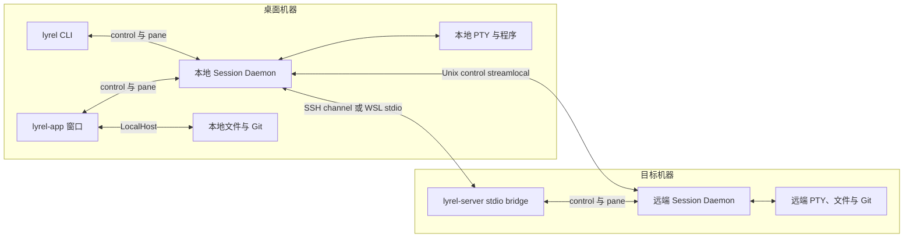

lyrel 是面向桌面本地开发与桌面远程开发的 Rust 原生终端工作台。本页面向维护者，说明当前实现的分层、状态所有者与跨边界约束，帮助判断修改应放在哪一层；使用方式见[核心概念](/getting-started/concepts)，视觉与交互约束见[界面设计规范](https://github.com/dlivxpr/lyrel/blob/main/docs/design-system.md)。

本文描述现行设计，不将历史迁移方案或验收计划视为已实现能力。依赖与平台构建条件以 [Cargo 配置](https://github.com/dlivxpr/lyrel/blob/main/Cargo.toml)、`Cargo.lock` 和[安装指南](/getting-started/installation#building-from-source)为准。

## 可执行程序与共享核心

workspace 包含六个 crate；桌面 GUI、CLI 和 headless server 复用 `lyrel-core`，文本 codec 属于 GUI-free `lyrel-text`，Markdown 编辑实现单独属于 desktop-only `lyrel-markdown-editor`。

| crate／程序 | 职责 | 不负责 |
| --- | --- | --- |
| 根包 `lyrel`，程序 `lyrel-app` | GPUI 窗口、终端呈现、编辑器、工作台、平台凭据与桌面集成 | 不在 GUI 层复制 daemon 或 Host 实现 |
| `lyrel-core` | 领域模型、配置与持久化、Host、daemon、PTY、SSH、IPC 和 agent 集成的共享逻辑 | 不依赖 GPUI 或系统钥匙串 |
| `lyrel-cli`，程序 `lyrel` | 面向人和 agent 的命令、目标解析、输出与退出码 | 不要求 GUI 正在运行 |
| `lyrel-server` | headless daemon 入口，以及 control／pane 的 stdio 服务和桥接 | 不依赖桌面组件；唯一生产依赖是 `lyrel-core` |
| `lyrel-text` | 编码、BOM、逐行行尾与 EditorConfig 策略，供普通文件工作台和 Markdown Document 复用 | 不依赖 GPUI、app 或 Host |
| `lyrel-markdown-editor` | 固定 MIT Zorite editor/bidi/ratex 源码的独立维护，Document/history 与各 presentation 的 native editing | 不拥有文件 I/O、Host/path、dirty/save/close，不导入 GPL 应用 |
| 根包内的 `lyrel-updater` | 启用 `updater` feature 后构建的 Windows 独立更新程序 | 不是独立 crate，也不是会话服务器 |

`src/daemon.rs` 重导出共享 daemon，`src/core/` 在共享核心之上增加 GUI 适配。桌面入口的 `--daemon` 模式在启动 GPUI 前转入共享 daemon，因此后台服务器可以由 `lyrel-app --daemon` 或独立 `lyrel-server --daemon` 承载。

GUI 通过 `gpui-kit =0.9.1` 的官方 `gpui-fast` feature 选择 Fast，应用导入与测试宏仍使用 `gpui_kit` facade。GUI、daemon 图形镜像与 CLI capture 共用 `rio-vt =0.5.29` 的解析器和网格；Rio 的默认 features 关闭，不引入其 PTY、窗口或 GPU 渲染栈。平台 PTY 和终端绘制仍由 lyrel 自己接入。

## 进程与连接拓扑

Session Daemon 是独立进程，持有会话资源；关闭窗口不会关闭它持有的 shell。远程工作区的权威 daemon 位于目标机器，桌面保留本地窗口与连接适配。

图中的 stdio bridge 与持久 daemon 是不同生命周期。Unix 的 control 路径优先尝试 SSH `direct-streamlocal`，不可用时执行 `--stdio`；Unix 的 `--stdio` 也可在当前进程服务 Host 请求。Windows 的 stdio 入口只做桥接；`--stdio --pane` 在两类平台上都转接到 pane daemon。一次 SSH exec／stdio 进程退出不等于远端会话结束。

原生 SSH 窗格由本地 daemon 直接打开 SSH shell channel，远端无需安装 `lyrel-server`；远程工作区则通过目标机器的 server 提供文件、Git、目录监视、工作区树和 pane。远程工作区内的客户端原生 SSH pane 仍属于本地 daemon，其组合呈现保存在本地 scoped sidecar，不变成远端主机器树的 pane。

CLI 的 `-m` 复用本地 daemon 已连接的机器路由，不自行建立新的 SSH 连接。连接发现、安装与认证仍由现有机器连接流程负责。

## 模块与状态归属

状态与转换规则放在同一个能力所有者中。`LyrelApp` 是每窗口的根 Entity，保留视图组合、跨能力导航与焦点交接；跨窗口共享的连接、镜像与注册表使用 GPUI `Global`，再按 Host 或工作区分片。能力模块不接收整个可变工作台。

| 状态或能力 | 所有者 | 作用域 | 边界 |
| --- | --- | --- | --- |
| 机器、工作区、标签页与 pane 记录 | `MachineStore` | 每 daemon | 唯一事务与机器树持久化入口 |
| 窗格会话与平台资源 | `DaemonPane` 及其能力模块 | 每 daemon pane | 持有 PTY／child 或 SSH channel、输出历史、控制权与图片权威状态 |
| GUI 机器级镜像 | `MachineMirrors` | 进程 Global，按 Host | 接收快照与 delta；拉取期间重放本地写入，不替代 store |
| 窗口布局同步 | `TreeSync` 内的 `WindowSync` | 进程 Global，按工作区 | projection 投影 desired tree，reconcile 规划有序操作，`WindowSync` 管理批次与恢复 epoch |
| 标签页与窗格呈现 | `Tab`、`TabSet`、`SessionLifecycle` | 每窗口 | 管理逻辑树、可见布局、焦点记忆与客户端恢复记录；持久布局仍属于 daemon |
| 延迟创建与附着 | `PendingPane` | 每 connecting slot Entity | 管理创建代次、失败、取消和合法结果安装 |
| 窗口连接 | `WindowConnection` | 每窗口 | 管理手动连接尝试与待创建工作区意图 |
| 共享机器连接 | `RemoteLinks`、`HostLinks`、`LocalLink` | 进程 Global | 监督机器连接、control link、本地 daemon、重连与 pane relink，各自保留原有职责 |
| 文件树／SCM | `FileTreeState`／`ScmPanelState` | 每窗口 | 管理各自加载、失效和转换；工作台适配 Host 调度、确认与导航 |
| 文档面板与缓冲区 | `EditorPanelState`／`EditorBuffers` | 每窗口编辑面板 | 管理文档加载、监视、导航、保存及未保存提示 |
| Markdown／MDX 原文与撤销 | `lyrel_markdown_editor::Document` | 每文档 | 一份 LF 原文、逐行表示、格式、history 与 revision；每个 `EditorState` presentation 独立持有选择、焦点、滚动、IME 与几何缓存 |
| 终端客户端与绘制 | `RemoteTerminal`、`PaneConnection`、`TerminalView`、`TerminalElement` | 每客户端 pane | 按连接、流消费、实体适配与逐帧绘制分工，桌面缓存不是会话权威 |
| 终端交互 | `PromptInput`、`Composer`、`AgentActivity`、搜索与滚动状态 | 每客户端 pane | 各自拥有输入、agent 消息框、活动与交互转换，生命周期任务归 `TerminalLifecycle` |
| 应用通知历史 | `InboxGlobal` 内的 `Inbox` | 进程共享；每窗一个 `NotificationBell` | 本机有界持久化，与 daemon 和系统通知中心解耦 |

逻辑 pane 不等于当前可见的分屏叶。PiP 和停放改变 `Tab.presentation` 的可见投影，不删除完整逻辑树中的会话，也不能被同步差分解释成 `PaneClose`。休眠与会话恢复使用各自的生命周期规则，不能仅凭视图未挂载就销毁 PTY。

## Host 与线程边界

工作区路径属于对应 Host，不默认属于桌面文件系统。文件、Git、搜索、目录监视和进程查询使用 `Host`／`SharedHost`：`LocalHost` 操作当前机器，`RemoteHost` 将请求编码到 control 连接，由目标侧执行。

GUI 通过 `HostOps::run`／`run_in` 将阻塞操作交给 Host 工作线程，再通过 GPUI context 应用结果与展示错误。窗口侧异步沿用 `cx.spawn` 与 executor；daemon 使用 std 线程和 channel，SSH 引擎另有 Tokio runtime。不能把这些执行环境当成同一个 runtime，也不能在 UI 线程等待静默 socket reader 退出。

异步结果同时受目标身份与连接生命周期约束。同一个 `HostId` 可以跨重连保持不变，但新的 `SharedHost` 实例代表新的连接；文件索引、树、搜索、quick-open 和仓库请求不能让旧实例的结果覆盖新实例。Host 路径判断也由对应 Host 决定，不能用桌面 OS 的路径规则解析远端路径。

系统凭据存储留在 GUI。共享核心只保存无秘密的 `CredentialRef` 与配置模型，认证提示经既有 SSH prompt／机器级队列处理，不把钥匙串依赖或 GUI 交互下沉到 headless server。

## 两套 IPC 协议

control 与 pane 分别协商协议；应用版本、control 版本和 pane 版本是三个独立标识。当前组合如下：

| 协议 | 源码常量 | 当前版本 | 承载内容 |
| --- | --- | ---: | --- |
| control | `daemon/control.rs` 的 `CONTROL_VERSION` | 16 | Host 操作、机器树、工作区附着、事件、文件／Git 流和主机指标 |
| pane | `daemon/protocol.rs` 的 `PROTOCOL_VERSION` | 17 | 创建／附着／观察、输入输出、尺寸、终端模式、agent 状态与图形回放 |

本地 Unix 使用私有 Unix socket，Windows 使用经认证的 loopback TCP；远端通过 SSH／stdio 桥接这些流。远端 server 文件名包含两套版本，当前为 `lyrel-server-c16p17`，Windows 加 `.exe`。

control 的 HELLO 在请求循环前核对版本与 features。增删 wire 消息变体需提升 control 版本，可安全忽略的字段才使用 feature 协商。pane 在实际 endpoint 上先协商版本和有限图形容量，再创建或附着会话；不兼容连接不能先启动 shell 再报告错误。

工作区附着与 pane 输入控制权是不同层级。工作区接管更新机器记录与 live attachment registry；pane 的控制器可以输入，observer 始终只读。替换控制器不移除 observer，慢 observer 的独立背压不能阻塞控制器输出。

远端安装先核对目标平台、安装许可、资产来源、SHA-256 和实际协议，再发布程序。缺包、校验或协议失败不会回退其他产品的资产或静默忽略功能，具体路径见[远程安装](/remote/workspaces#what-gets-installed)。

## 终端输出与绘制

终端使用一条有序输出流连接会话权威与桌面派生状态；文字、几何、模式和图形不能各自建立竞争消费者。

1. daemon 的平台生命周期接入 PTY／child 或原生 SSH channel；launch 准备 shell、环境与工作目录，reader 按输出顺序推进 pane 状态。
2. daemon 保存有界文字回放和几何分段，同时维护 Kitty 图片资源、独立放置、历史锚点与播放时间线。订阅者先获得一致的回放基线，再进入实时输出。
3. 桌面的 `PaneHandshake` 完成路由与接入，`PaneConnection` 配对 reader／writer；`ReaderTask` 管理一次 reader 生命周期，`FrameReader` 顺序消费帧并推进 Rio 网格、模式、解码与回放位置。`LinkWriter` 管理输入队列和背压。
4. `TerminalLifecycle` 拥有事件 receiver 与批量唤醒，`TerminalView` 适配交互、标题、agent 活动和通知。transport 断开不等于 child 退出，只有真实进程退出才产生 `ChildExited`。
5. `TerminalElement` 保留唯一的 `request_layout` → `prepaint` → `paint` 管线和命中几何。稳态 grid 锁竞争时保留上一有效帧并重试；输入仍读取 live 模式，不以旧帧模式解释新按键。

隐藏 pane 继续消费输出、更新必要状态并释放退休图片资源，但普通输出不触发整窗重绘。daemon 持有图片权威，桌面只保留受预算约束的解码／绘制缓存；图片回收与连接退休不能通过隐藏副本绕过资源上限。

同步更新期间，解析、协议应答和输入模式仍实时推进，桌面只延迟发布新的文字、光标和图片帧。结束标记或既有 150 ms fail-safe 解除冻结；CLI `capture --plain` 重建最新收到的状态，不等待 GUI 已提交帧。图形协议范围与历史验收记录见[终端内联图片](/getting-started/concepts#终端内联图片)。

## 创建、重连与结果失效

异步工作必须证明自己仍属于当前目标，不能以一次任务完成作为安装结果、关闭对象或夺取焦点的依据。

- **创建：**`app/pane_binding.rs` 放置 connecting slot 并启动 `PendingPane`。结果领取核对工作区和 slot Entity；关闭、替换或离开后，晚到结果无权安装。只有原 slot 仍持有焦点时，完成安装才交接焦点。
- **附着：**attach-only 只附着原 pane。静默、断流、图形容量不足或握手失败不证明 pane 消失；只有明确的“pane 不存在”应答允许放弃原会话。
- **连接：**`WindowConnection` 用不复用的 `AttemptId` 关联窗口尝试和创建意图，`RemoteLinks` 独占共享机器重连与 relink。窗口流程结束不等于关闭共享机器连接。
- **链接替换：**先退休旧 reader／decoder 代次，再安装 successor、替换 writer、重新发布 viewport 并同步尺寸；旧帧、事件与解码完成不能污染新连接。
- **布局恢复：**`WindowSync` 用 epoch 隔离旧批次和恢复结果。`Full` 与 `Additive` 的删除权限不同；尚在创建、重建失败或未获知的标签页不能被推断为已经关闭，只有明确关闭意图才允许删除。

自动重连不争抢其他客户端持有的工作区；主动接管与自动恢复的权限不同。恢复中的本地新操作优先于旧快照，详见[远程工作区的重连与同步](/remote/workspaces#reattaching)。

## 持久化和恢复

机器树、窗口偏好与终端历史各有存储，不把 GUI 的最后一次显示当作机器上的全部会话。

| 数据 | 存储／所有者 | 恢复边界 |
| --- | --- | --- |
| 配置与 SSH 资料 | 实例配置目录中的配置文件 | 保存偏好与无秘密的引用；目录解析由共享配置层负责 |
| 机器树 | `MachineStore` 写入 `machine.json` | 保留工作区、标签页、pane 记录和布局；不使已结束进程复活 |
| 客户端工作区视图 | `WindowViews` 写入 `views.json` | 记录本客户端打开的工作区、远端引用与视图偏好，不代替机器树 |
| 窗口几何 | `WindowState` 写入 `window.json` | 恢复有效尺寸与位置，不拥有会话 |
| 终端文字历史 | daemon 的有界 replay 与 `scrollback/` 存储后缀 | 存活 attach 使用内存回放；daemon 重启后的磁盘文字恢复是另一条路径 |
| 终端图片 | 存活 pane daemon 的资源与放置 | 仅在历史与预算允许范围内重新附着；不新增图片磁盘缓存 |
| SSH 秘密 | GUI 使用系统凭据存储 | 不序列化到机器树，也不交给 headless server 的配置模型 |

`MachineStore` 对结构变更先校验，在锁内修改并同步持久化，失败回滚，接受后按序发布通知。pane facts 与活跃时间沿用延迟写盘，不承诺每条通知前都已落盘；连接 attachment 只在内存中。机器文件使用原子写入、间隔备份与损坏隔离，路径查询本身不迁移数据。

配置目录覆盖顺序为 `--config-dir`、`LYREL_CONFIG_DIR`、便携模式、默认目录。机器树与外观提示默认跟随实例配置目录，显式 `LYREL_DATA_DIR` 可覆盖两者；隔离运行不能意外共写真实实例的数据。

关闭 GUI 后重新附着存活 daemon，保留的是原会话。daemon 或机器重启后，布局恢复需要重新创建 shell；当前 GUI 只向支持 `restore-scrollback` 的本地 daemon 请求磁盘文字回放，远端 daemon 重启后的 shell 重建不请求该历史。agent 的 resume 是独立能力，不等于 shell 或图片跨 daemon 重启存活。

Unix 的 daemon handoff 是独立的升级路径：通过 exec 继承本地 PTY 与进程，不等同于普通停启；原生 SSH pane 不随它保活。Windows 不支持这条 handoff 路径，不能据此承诺升级后原 shell 存活。

## 编辑器与 agent 的边界

文档编辑与终端输入是不同能力，两者都不引入 WebView 或代理第三方应用界面。

文件缓冲区按 Host 与文档身份加载、监视和保存。编辑器用工作区、`HostId`、目标文档／分组与请求序号核对结果，恢复另有 `context_epoch`；这与文件树按 Host adapter 实例隔离不是同一机制。

Markdown 只有独立维护的 Zorite-derived `lyrel-markdown-editor` 默认即时编辑路线，GUI 仅经 GPUI Kit/Fast。工作台拥有 Host/path、dirty、save/close 与状态，`lyrel-text` 共享原 Apache-2.0 codec/EditorConfig；editor 不依赖 app/core。live/source 不建立第二份源文或 history，所有 source range edit/Undo/Redo 走同一 `DocumentEvent`。Document 在同一事务中更新 LF 原文与逐行表示，保存捕获源文、格式、表示和原 owning Host/path，不以焦点视图决定异步目标。

每个 presentation 都安装 writing、table/code、owning-Host 图片/链接、结构公式及 Mermaid provider。普通链接采用 release 单击，caret 附近按上游语义显露标记；不保留旧 Ctrl+Click-only、始终隐藏标记或旧 WYSIWYG fallback。MDX 是 source-only，旧 rich component/inspector/workspace embed 已退役；frontmatter 和未知语法保留源码，不执行项目组件。公式与图形在 native Rust 中呈现，不使用浏览器或 Node.js 编辑器。

源码例外只涵盖 pinned Zorite `9f069c73a56b06efc84fb7abb700beb50083c827` 的 MIT editor/bidi/ratex 16 文件；registry `zorite-markdown =0.10.1` 仅提供 GUI-free syntax。`UPSTREAM.toml` 记录原始 Git blob 摘要和本地适配，MIT notices 与字体许可进入根 `LICENSE` 并沿平台打包链分发。保留 imported bidi mapping 与超长 nowrap 行的 source-preserving 有界视觉布局；#235 为 `not_planned`，不是 native long-line 或 full RTL 已修复的证明，完整 RTL 仍在已批准验收范围之外。全部源码接线与验收边界见 `HOST_CAPABILITIES.md`；最终 native/实窗/平台与真实 SSH 结果分别记录。LSP 仍属于桌面，headless 不引入 GUI。

coding agent 在真实 PTY 中运行自己的原生 TUI。命令识别、状态 hooks、会话历史、resume／fork 与启动任务投递是独立能力；hooks／产品 SDK bridge 是状态观测与任务交互通道，不替代 agent 界面。内置产品与能力边界见[agent 概览](/agents/overview)和[会话操作](/agents/sessions)，其中 pi 与 omp 是独立产品，名称识别不构成全部能力已经验收的声明。

## 桌面本地服务

通知、本地化与用量账号属于桌面应用，不是远端工作区状态。

- **通知历史：**`ui::notification_history` 记录应用收到的 Toast，最多保留 500 条；内存修改在 GPUI 事件循环串行执行，单一 writer 按同序原子写盘。它不是 daemon 事件日志，也不读取系统通知中心。
- **本地化：**`ui::i18n` 以 `L10nKey` 维护 `en`／`zh-CN`，`system` 只是选择模式。配置热重载按变化刷新窗口、菜单、快捷键与 Windows Explorer 动词，不用 PTY locale 决定界面语言。
- **用量账号：**`ui::settings::usage` 的账号和 `lyrel-usage` 凭据域仅供桌面用量查询，与 SSH 凭据、远端 Host 和 agent 配置分离。

## 修改位置与验证边界

修改共享行为时先找领域所有者，再补消费者适配；不在另一个入口复制同一套实现。

| 修改内容 | 源码入口 |
| --- | --- |
| 进程角色与桌面启动 | [`src/lib.rs::run`](https://github.com/dlivxpr/lyrel/blob/main/src/lib.rs)（[`src/main.rs`](https://github.com/dlivxpr/lyrel/blob/main/src/main.rs) 为薄 binary）、[`lyrel-server` 入口](https://github.com/dlivxpr/lyrel/blob/main/crates/lyrel-server/src/main.rs) |
| 共享领域、事务与数据目录 | [`core/machine/`](https://github.com/dlivxpr/lyrel/tree/main/crates/lyrel-core/src/core/machine)、[`core/session.rs`](https://github.com/dlivxpr/lyrel/blob/main/crates/lyrel-core/src/core/session.rs) |
| Host 与 control 服务 | [`host/`](https://github.com/dlivxpr/lyrel/tree/main/crates/lyrel-core/src/host)、[`ui/host_ops.rs`](https://github.com/dlivxpr/lyrel/blob/main/src/ui/host_ops.rs) |
| PTY、pane 与 SSH 路由 | [`daemon/`](https://github.com/dlivxpr/lyrel/tree/main/crates/lyrel-core/src/daemon) |
| 窗口组合与能力所有者 | [`ui/app.rs`](https://github.com/dlivxpr/lyrel/blob/main/src/ui/app.rs)、[`ui/`](https://github.com/dlivxpr/lyrel/tree/main/src/ui) |
| 终端连接、交互与绘制 | [`terminal/`](https://github.com/dlivxpr/lyrel/tree/main/src/terminal) |
| CLI 命令与依赖替换点 | [`lyrel-cli/src/`](https://github.com/dlivxpr/lyrel/tree/main/crates/lyrel-cli/src)，沿用 `Backend` trait |

桌面只支持 Windows／macOS；Linux 保留 core、server、CLI 与 GUI-free `lyrel-text`，显式排除根桌面包及 `lyrel-markdown-editor`，不预留手机网关。Windows 使用已核验、配套分发的官方 ConPTY。依赖与平台选择见[安装指南](/getting-started/installation)，编译成功不推导原生或跨平台行为通过。

验证需匹配被修改的边界：共享行为使用对应 core／server／CLI 用例和真实 daemon／PTY 路径；GUI 行为还需实际窗口观察；Unix、Windows、macOS 与真实 SSH 的证据分别记录。历史工单中的测试计数、二进制身份、失败与未验证项保留在原记录，不作为当前源码已重新验收的声明。
