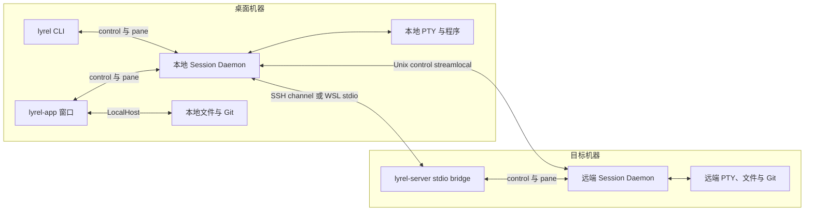

lyrel 是面向桌面本地开发与桌面远程开发的 Rust 原生终端工作台。本页面向维护者，说明当前实现的分层、状态所有者与跨边界约束，帮助判断修改应放在哪一层；使用方式见[核心概念](/getting-started/concepts)，视觉与交互约束见[界面设计规范](https://github.com/dlivxpr/lyrel/blob/main/docs/design-system.md)。

本文描述现行设计，不将历史迁移方案或验收计划视为已实现能力。依赖与平台构建条件以 [Cargo 配置](https://github.com/dlivxpr/lyrel/blob/main/Cargo.toml)、`Cargo.lock` 和[安装指南](/getting-started/installation#building-from-source)为准。

## 可执行程序与共享核心

workspace 包含六个 crate；桌面 GUI、CLI 和 headless server 复用 `lyrel-core`，文本 codec 属于 GUI-free `lyrel-text`，Markdown 编辑实现单独属于 desktop-only `lyrel-markdown-editor`。

| crate／程序 | 职责 | 不负责 |
| --- | --- | --- |
| 根包 `lyrel`，程序 `lyrel-app` | GPUI 窗口、终端呈现、编辑器、工作台、平台凭据与桌面集成 | 不在 GUI 层复制 daemon 或 Host 实现 |
| `lyrel-core` | 领域模型、配置与持久化、Host、daemon、PTY、SSH、IPC 和 agent 集成的共享逻辑 | 不依赖 GPUI 或系统钥匙串 |
| `lyrel-cli`，程序 `lyrel` | 面向人和 agent 的命令、目标解析、输出与退出码 | 不要求 GUI 正在运行 |
| `lyrel-server` | headless daemon 入口，以及 control／pane 的 stdio 服务和桥接 | 不依赖桌面组件；唯一生产依赖是 `lyrel-core` |
| `lyrel-text` | 编码、BOM、逐行行尾与 EditorConfig 策略，供普通文件工作台和 Markdown Document 复用 | 不依赖 GPUI、app 或 Host |
| `lyrel-markdown-editor` | 固定 MIT Zorite editor/bidi/ratex 源码的独立维护，Document/history 与各 presentation 的 native editing | 不拥有文件 I/O、Host/path、dirty/save/close，不导入 GPL 应用 |
| 根包内的 `lyrel-updater` | 启用 `updater` feature 后构建的 Windows 独立更新程序 | 不是独立 crate，也不是会话服务器 |

`src/daemon.rs` 重导出共享 daemon，`src/core/` 在共享核心之上增加 GUI 适配。桌面入口的 `--daemon` 模式在启动 GPUI 前转入共享 daemon，因此后台服务器可以由 `lyrel-app --daemon` 或独立 `lyrel-server --daemon` 承载。

GUI 通过 `gpui-kit =0.9.1` 的官方 `gpui-fast` feature 选择 Fast，应用导入与测试宏仍使用 `gpui_kit` facade。GUI、daemon 图形镜像与 CLI capture 共用 `rio-vt =0.5.30` 的解析器和网格；Rio 的默认 features 关闭，不引入其 PTY、窗口或 GPU 渲染栈。平台 PTY 和终端绘制仍由 lyrel 自己接入。

## 进程与连接拓扑

Session Daemon 是独立进程，持有会话资源；关闭窗口不会关闭它持有的 shell。远程工作区的权威 daemon 位于目标机器，桌面保留本地窗口与连接适配。

图中的 stdio bridge 与持久 daemon 是不同生命周期。Unix 的 control 路径优先尝试 SSH `direct-streamlocal`，不可用时执行 `--stdio`；Unix 的 `--stdio` 也可在当前进程服务 Host 请求。Windows 的 stdio 入口只做桥接；`--stdio --pane` 在两类平台上都转接到 pane daemon。一次 SSH exec／stdio 进程退出不等于远端会话结束。

原生 SSH 窗格由本地 daemon 直接打开 SSH shell channel，远端无需安装 `lyrel-server`；远程工作区则通过目标机器的 server 提供文件、Git、目录监视、工作区树和 pane。远程工作区内的客户端原生 SSH pane 仍属于本地 daemon，其组合呈现保存在本地 scoped sidecar，不变成远端主机器树的 pane。

CLI 的 `-m` 复用本地 daemon 已连接的机器路由，不自行建立新的 SSH 连接。连接发现、安装与认证仍由现有机器连接流程负责。

## 模块与状态归属

状态与转换规则放在同一个能力所有者中。`LyrelApp` 是每窗口的根 Entity，保留视图组合、跨能力导航与焦点交接；跨窗口共享的连接、镜像与注册表使用 GPUI `Global`，再按 Host 或工作区分片。能力模块不接收整个可变工作台。

| 状态或能力 | 所有者 | 作用域 | 边界 |
| --- | --- | --- | --- |
| 机器、工作区、标签页与 pane 记录 | `MachineStore` | 每 daemon | 唯一事务与机器树持久化入口 |
| 窗格会话与平台资源 | `DaemonPane` 及其能力模块 | 每 daemon pane | 持有 PTY／child 或 SSH channel、输出历史、控制权与图片权威状态 |
| GUI 机器级镜像 | `MachineMirrors` | 进程 Global，按 Host | 接收快照与 delta；拉取期间重放本地写入，不替代 store |
| 窗口布局同步 | `TreeSync` 内的 `WindowSync` | 进程 Global，按工作区 | projection 投影 desired tree，reconcile 规划有序操作，`WindowSync` 管理批次与恢复 epoch |
| 标签页与窗格呈现 | `Tab`、`TabSet`、`SessionLifecycle` | 每窗口 | 管理逻辑树、可见布局、焦点记忆与客户端恢复记录；持久布局仍属于 daemon |
| 延迟创建与附着 | `PendingPane` | 每 connecting slot Entity | 管理创建代次、失败、取消和合法结果安装 |
| 窗口连接 | `WindowConnection` | 每窗口 | 管理手动连接尝试与待创建工作区意图 |
| 共享机器连接 | `RemoteLinks`、`HostLinks`、`LocalLink` | 进程 Global | 监督机器连接、control link、本地 daemon、重连与 pane relink，各自保留原有职责 |
| 文件树／SCM | `FileTreeState`／`ScmPanelState` | 每窗口 | 管理各自加载、失效和转换；工作台适配 Host 调度、确认与导航 |
| 文档面板与缓冲区 | `EditorPanelState`／`EditorBuffers` | 每窗口编辑面板 | 管理文档加载、监视、导航、保存及未保存提示 |
| Markdown／MDX 原文与撤销 | `lyrel_markdown_editor::Document` | 每文档 | 一份 LF 原文、逐行表示、格式、history 与 revision；每个 `EditorState` presentation 独立持有选择、焦点、滚动、IME 与几何缓存 |
| 终端客户端与绘制 | `RemoteTerminal`、`PaneConnection`、`TerminalView`、`TerminalElement` | 每客户端 pane | 按连接、流消费、实体适配与逐帧绘制分工，桌面缓存不是会话权威 |
| 终端交互 | `PromptInput`、`Composer`、`AgentActivity`、搜索与滚动状态 | 每客户端 pane | 各自拥有输入、agent 消息框、活动与交互转换，生命周期任务归 `TerminalLifecycle` |
| 应用通知历史 | `InboxGlobal` 内的 `Inbox` | 进程共享；每窗一个 `NotificationBell` | 本机有界持久化，与 daemon 和系统通知中心解耦 |

逻辑 pane 不等于当前可见的分屏叶。PiP 和停放改变 `Tab.presentation` 的可见投影，不删除完整逻辑树中的会话，也不能被同步差分解释成 `PaneClose`。休眠与会话恢复使用各自的生命周期规则，不能仅凭视图未挂载就销毁 PTY。

## Host 与线程边界

工作区路径属于对应 Host，不默认属于桌面文件系统。文件、Git、搜索、目录监视和进程查询使用 `Host`／`SharedHost`：`LocalHost` 操作当前机器，`RemoteHost` 将请求编码到 control 连接，由目标侧执行。

GUI 通过 `HostOps::run`／`run_in` 将阻塞操作交给 Host 工作线程，再通过 GPUI context 应用结果与展示错误。窗口侧异步沿用 `cx.spawn` 与 executor；daemon 使用 std 线程和 channel，SSH 引擎另有 Tokio runtime。不能把这些执行环境当成同一个 runtime，也不能在 UI 线程等待静默 socket reader 退出。

异步结果同时受目标身份与连接生命周期约束。同一个 `HostId` 可以跨重连保持不变，但新的 `SharedHost` 实例代表新的连接；文件索引、树、搜索、quick-open 和仓库请求不能让旧实例的结果覆盖新实例。Host 路径判断也由对应 Host 决定，不能用桌面 OS 的路径规则解析远端路径。

系统凭据存储留在 GUI。共享核心只保存无秘密的 `CredentialRef` 与配置模型，认证提示经既有 SSH prompt／机器级队列处理，不把钥匙串依赖或 GUI 交互下沉到 headless server。

## 两套 IPC 协议

control 与 pane 分别协商协议；应用版本、control 版本和 pane 版本是三个独立标识。当前组合如下：

| 协议 | 源码常量 | 当前版本 | 承载内容 |
| --- | --- | ---: | --- |
| control | `daemon/control.rs` 的 `CONTROL_VERSION` | 16 | Host 操作、机器树、工作区附着、事件、文件／Git 流和主机指标 |
| pane | `daemon/protocol.rs` 的 `PROTOCOL_VERSION` | 19 | 创建／附着／观察、输入输出、尺寸、终端模式、agent 状态、图形回放、当前进度、pane 颜色、XTGETTCAP、Glyph 注册／查询／保留投影与 iTerm2 精确显示像素 |

本地 Unix 使用私有 Unix socket，Windows 使用经认证的 loopback TCP；远端通过 SSH／stdio 桥接这些流。远端 server 文件名包含两套版本，当前为 `lyrel-server-c16p19`，Windows 加 `.exe`。

control 的 HELLO 在请求循环前核对版本与 features。增删 wire 消息变体需提升 control 版本，可安全忽略的字段才使用 feature 协商。pane 在实际 endpoint 上先协商版本和有限图形容量，再创建或附着会话；不兼容连接不能先启动 shell 再报告错误。

工作区附着与 pane 输入控制权是不同层级。工作区接管更新机器记录与 live attachment registry；pane 的控制器可以输入，observer 始终只读。替换控制器不移除 observer，慢 observer 的独立背压不能阻塞控制器输出。

远端安装先核对目标平台、安装许可、资产来源、SHA-256 和实际协议，再发布程序。缺包、校验或协议失败不会回退其他产品的资产或静默忽略功能，具体路径见[远程安装](/remote/workspaces#what-gets-installed)。

## 终端输出与绘制

终端使用一条有序输出流连接会话权威与桌面派生状态；文字、几何、模式和图形不能各自建立竞争消费者。

1. daemon 的平台生命周期接入 PTY／child 或原生 SSH channel；launch 准备 shell、环境与工作目录，reader 按输出顺序推进 pane 状态。
2. daemon 保存有界文字回放和几何分段，同时维护 Kitty 图片资源、独立放置、历史锚点与播放时间线。订阅者先获得一致的回放基线，再进入实时输出。
   pane 级 Glyph Protocol glossary 同样由 daemon 权威持有：只接受 pinned v1.12 校验通过的 `glyf`（PUA、simple/unhinted、64 KiB wire/decoded、1024 FIFO），按请求的 `reply` 级别回复；接受的 `r`/`c` 原样按流位置重发，拒绝/畸形体剥离，RIS 在同一有序位置清空。`q` 不进入消费者：daemon 只向当前 controller 发起一次有界请求，捕获请求位置的 glossary 位，由 controller 用实际字体 fallback 回答 system 位，daemon 写唯一回复；无 controller 时保持静默，旧 token/重复答案丢弃。GUI 仅从接受体或权威投影重建每 pane 派生绘制（revision、FIFO 镜像），按 §8.5 的 pad → size → align 顺序处理声明 extent 或解码点 bbox（未声明 `contain` 受 em 上限），以主字体实际 baseline 对齐并 clip 到未扣 padding 的 render span，用单元格 effective foreground 绘制。`width=2` 只扩像素 span，末列、非空或已由邻格自行绘制的空白回退一列；不安装字体，不改 logical width、光标推进、换行、选择、复制、raw codepoint、普通 fallback、Powerline/boxdraw 或 Kitty placeholder。前景、几何、baseline、span、注册 revision 与 display scale 每帧参与派生，不复用紧凑 slot/version。
   绘制在 snapshot acquisition 时把注册资源身份（`Arc<GlyphView>`）捕获进单元格：live 单元格在下一次成功帧采用当前注册；未完成同步帧、grid 竞争复用帧与阅读行保留其捕获版本，直到该 buffer／reading 正常退休，最后一个 owner 释放后才回收 outline。RIS 仍按既有破坏性阅读重置规则丢弃阅读呈现并清空 live registry，不留下陈旧呈现代理。旧 endpoint 缺少 `glyph-registry`／`glyph-state` feature 时消费者不派生、不应答并提示更新 daemon。完整单色支持正常启用，不增加默认关闭的实验开关；GUI 仅向实际声明 `glyph-support` 的 endpoint 发送 `SubscribeGlyphRender`，daemon 仅在当前 controller 声明完整绘制能力时回答 `s`，且只广告 `fmt=glyf`。CLI／observer／仅订阅 state 的旧消费者、脱离及后续未声明能力的替代 controller 不继承该广告；远端以实际 pane 协商为准，不以本机 GUI 版本代替，也不自动替换 server 或终止 pane。
   接受的 glossary 不再依赖文字 ring 恢复：daemon 在 `glyph-registry` 之上新增可忽略的 `glyph-state` feature 与 client opt-in，附着时在 ring／图形／颜色回放之后发送有界全量 `GlyphState`（generation + 插入序注册；聚合 wire ≤4 MiB、decoded ≤8 MiB）。未 opt-in 的旧 client 不会收到 kind 72／73，controller 未 opt-in 时 `q` 保持静默；回放文字中的 glyph body 不用于派生。`c`／RIS 在流位置递增 generation，消费者原子替换 registry 并忽略更旧 generation，退休 link 的迟到结果由 link generation 隔离。同一 pane-session 的 Unix `exec` handoff 显式携带该 frame；磁盘 scrollback 剥离完整 glyph APC，旧 handoff 与 daemon 死亡后的新 shell 不复活旧 registry。超过聚合 wire／decoded 预算的注册明确失败，不静默丢弃已接受定义。
3. 桌面的 `PaneHandshake` 完成路由与接入，`PaneConnection` 配对 reader／writer；`ReaderTask` 管理一次 reader 生命周期，`FrameReader` 顺序消费帧并推进 Rio 网格、模式、解码与回放位置。`LinkWriter` 管理输入队列和背压。
4. `TerminalLifecycle` 拥有事件 receiver 与批量唤醒，`TerminalView` 适配交互、标题、agent 活动和通知。transport 断开不等于 child 退出，只有真实进程退出才产生 `ChildExited`。
5. `TerminalElement` 保留唯一的 `request_layout` → `prepaint` → `paint` 管线和命中几何。稳态 grid 锁竞争时保留上一有效帧并重试；输入仍读取 live 模式，不以旧帧模式解释新按键。

隐藏 pane 继续消费输出、更新必要状态并释放退休图片资源，但普通输出不触发整窗重绘。daemon 持有图片权威，桌面只保留受预算约束的解码／绘制缓存；图片回收与连接退休不能通过隐藏副本绕过资源上限。

单窗格进度由 `PaneFacts` 保存一个可选 `PaneProgress`，复用 `output_marks` 与原有 `OscTokenizer`
按顺序折叠 `OSC 9;4` 和命令边界，不另建 VT parser 或历史事件队列。`DaemonMsg::Progress` 在实际
v18 pane 流中发布有意义的变化，并在 attach 基线中始终发送当前状态（包括清空）；桌面不从回放文字
重建权威进度。支持的同进程 handoff 携带状态，磁盘 scrollback、机器树和新 Shell 不携带它。
`ProgressChanged` 只通知 tab owner 更新语义状态，不调用 agent lifecycle 或绕过隐藏 pane 的输出绘制门控。
标签页汇总直接从所属全部终端叶子的当前状态派生，包括未聚焦、隐藏和停放的叶子；它不写入机器树或
会话布局，也不经 agent payload 传递。成员变化、重连与重建后由新叶子及其 daemon 基线自然更新汇总；
休眠标签页没有叶子，因而没有瞬时进度可显示。

同步更新期间，解析、协议应答和输入模式仍实时推进，桌面只延迟发布新的文字、光标和图片帧。结束标记或既有 150 ms fail-safe 解除冻结；CLI `capture --plain` 重建最新收到的状态，不等待 GUI 已提交帧。图形协议范围与历史验收记录见[终端内联图片](/getting-started/concepts#终端内联图片)。

XTGETTCAP 同样只有 daemon 一个实时应答者，不随 controller 附着／脱离转移。
reader 复用既有有界 control-string framing，Rio public parser 识别 DCS header，完整且不超限的查询才进入
daemon 的 Rio `Handler::xtgettcap_response`；生成应答按解码名字重写为保守白名单。
查询 payload 不进入 replay ring、GUI 或 CLI parser，取消／超限查询也不会借普通输出路径绕过限制。
桌面 callback 对旧 snapshot 中残留的查询保持静默；实际 pane 协商必须确认 `xtgettcap-owner`，
不能以本机 build 的 feature 列表替代远端 endpoint 的保证。具体白名单和 `8192` 字节限制见
[终端能力发现](/terminal/mouse-and-scrolling#xtgettcap-discovery)。

## 创建、重连与结果失效

异步工作必须证明自己仍属于当前目标，不能以一次任务完成作为安装结果、关闭对象或夺取焦点的依据。

- **创建：**`app/pane_binding.rs` 放置 connecting slot 并启动 `PendingPane`。结果领取核对工作区和 slot Entity；关闭、替换或离开后，晚到结果无权安装。只有原 slot 仍持有焦点时，完成安装才交接焦点。
- **附着：**attach-only 只附着原 pane。静默、断流、图形容量不足或握手失败不证明 pane 消失；只有明确的“pane 不存在”应答允许放弃原会话。
- **连接：**`WindowConnection` 用不复用的 `AttemptId` 关联窗口尝试和创建意图，`RemoteLinks` 独占共享机器重连与 relink。窗口流程结束不等于关闭共享机器连接。
- **链接替换：**先退休旧 reader／decoder 代次，再安装 successor、替换 writer、重新发布 viewport 并同步尺寸；旧帧、事件与解码完成不能污染新连接。
- **布局恢复：**`WindowSync` 用 epoch 隔离旧批次和恢复结果。`Full` 与 `Additive` 的删除权限不同；尚在创建、重建失败或未获知的标签页不能被推断为已经关闭，只有明确关闭意图才允许删除。

自动重连不争抢其他客户端持有的工作区；主动接管与自动恢复的权限不同。恢复中的本地新操作优先于旧快照，详见[远程工作区的重连与同步](/remote/workspaces#reattaching)。

## 持久化和恢复

机器树、窗口偏好与终端历史各有存储，不把 GUI 的最后一次显示当作机器上的全部会话。

| 数据 | 存储／所有者 | 恢复边界 |
| --- | --- | --- |
| 配置与 SSH 资料 | 实例配置目录中的配置文件 | 保存偏好与无秘密的引用；目录解析由共享配置层负责 |
| 机器树 | `MachineStore` 写入 `machine.json` | 保留工作区、标签页、pane 记录和布局；不使已结束进程复活 |
| 客户端工作区视图 | `WindowViews` 写入 `views.json` | 记录本客户端打开的工作区、远端引用与视图偏好，不代替机器树 |
| 窗口几何 | `WindowState` 写入 `window.json` | 恢复有效尺寸与位置，不拥有会话 |
| 终端文字历史 | daemon 的有界 replay 与 `scrollback/` 存储后缀 | 存活 attach 使用内存回放；daemon 重启后的磁盘文字恢复是另一条路径 |
| 终端图片 | 存活 pane daemon 的资源与放置 | 仅在历史与预算允许范围内重新附着；不新增图片磁盘缓存 |
| SSH 秘密 | GUI 使用系统凭据存储 | 不序列化到机器树，也不交给 headless server 的配置模型 |

`MachineStore` 对结构变更先校验，在锁内修改并同步持久化，失败回滚，接受后按序发布通知。pane facts 与活跃时间沿用延迟写盘，不承诺每条通知前都已落盘；连接 attachment 只在内存中。机器文件使用原子写入、间隔备份与损坏隔离，路径查询本身不迁移数据。

配置目录覆盖顺序为 `--config-dir`、`LYREL_CONFIG_DIR`、便携模式、默认目录。机器树与外观提示默认跟随实例配置目录，显式 `LYREL_DATA_DIR` 可覆盖两者；隔离运行不能意外共写真实实例的数据。

关闭 GUI 后重新附着存活 daemon，保留的是原会话。daemon 或机器重启后，布局恢复需要重新创建 shell；当前 GUI 只向支持 `restore-scrollback` 的本地 daemon 请求磁盘文字回放，远端 daemon 重启后的 shell 重建不请求该历史。agent 的 resume 是独立能力，不等于 shell 或图片跨 daemon 重启存活。

Unix 的 daemon handoff 是独立的升级路径：通过 exec 继承本地 PTY 与进程，不等同于普通停启；原生 SSH pane 不随它保活。Windows 不支持这条 handoff 路径，不能据此承诺升级后原 shell 存活。

## 编辑器与 agent 的边界

当前的文档编辑与终端输入是不同能力，两者均未引入 WebView 或代理第三方应用界面。下方[文件能力扩展设计](#file-capability-design)仅为待实现的 draw.io 本机引擎定义局部例外，不改变当前行为，也不授权普通文本、Markdown 或终端执行任意网页脚本。

文件缓冲区按 Host 与文档身份加载、监视和保存。编辑器用工作区、`HostId`、目标文档／分组与请求序号核对结果，恢复另有 `context_epoch`；这与文件树按 Host adapter 实例隔离不是同一机制。

Markdown 只有独立维护的 Zorite-derived `lyrel-markdown-editor` 默认即时编辑路线，GUI 仅经 GPUI Kit/Fast。工作台拥有 Host/path、dirty、save/close 与状态，`lyrel-text` 共享原 Apache-2.0 codec/EditorConfig；editor 不依赖 app/core。live/source 不建立第二份源文或 history，所有 source range edit/Undo/Redo 走同一 `DocumentEvent`。Document 在同一事务中更新 LF 原文与逐行表示，保存捕获源文、格式、表示和原 owning Host/path，不以焦点视图决定异步目标。

每个 presentation 都安装 writing、table/code、owning-Host 图片/链接、结构公式及 Mermaid provider。普通链接采用 release 单击，caret 附近按上游语义显露标记；不保留旧 Ctrl+Click-only、始终隐藏标记或旧 WYSIWYG fallback。MDX 是 source-only，旧 rich component/inspector/workspace embed 已退役；frontmatter 和未知语法保留源码，不执行项目组件。公式与图形在 native Rust 中呈现，不使用浏览器或 Node.js 编辑器。

源码例外只涵盖 pinned Zorite `9f069c73a56b06efc84fb7abb700beb50083c827` 的 MIT editor/bidi/ratex 16 文件；registry `zorite-markdown =0.10.1` 仅提供 GUI-free syntax。`UPSTREAM.toml` 记录原始 Git blob 摘要和本地适配，MIT notices 与字体许可进入根 `LICENSE` 并沿平台打包链分发。保留 imported bidi mapping 与超长 nowrap 行的 source-preserving 有界视觉布局；#235 为 `not_planned`，不是 native long-line 或 full RTL 已修复的证明，完整 RTL 仍在已批准验收范围之外。全部源码接线与验收边界见 `HOST_CAPABILITIES.md`；最终 native/实窗/平台与真实 SSH 结果分别记录。LSP 仍属于桌面，headless 不引入 GUI。

coding agent 在真实 PTY 中运行自己的原生 TUI。命令识别、状态 hooks、会话历史、resume／fork 与启动任务投递是独立能力；hooks／产品 SDK bridge 是状态观测与任务交互通道，不替代 agent 界面。内置产品与能力边界见[agent 概览](/agents/overview)和[会话操作](/agents/sessions)，其中 pi 与 omp 是独立产品，名称识别不构成全部能力已经验收的声明。

## 文件能力扩展设计（已确认，待实现）

本节记录后续文件能力的架构约束，不描述已实现功能。产品范围、术语、逐格式支持深度及验收要求以[文件能力扩展设计](/window/side-panel#file-format-plan)为准；Office、Notebook、kernel 与 Plotly 均不在本轮范围。

### 文件打开与状态归属

文件打开入口需要按格式选择文本编辑、只读阅读或格式编辑，不再要求所有文件先成为文本 buffer。

- 工作台继续拥有文档身份、所属 Host/path、打开请求、dirty、保存／另存为／冲突／关闭、tabs/groups 和焦点交接。格式实现不直接操作文件树或绕过所属 Host 写盘。
- 当前 `src/ui/code_editor/buffers.rs` 的 `EditorBuffers` 和 `Loaded` 面向文本，整文件读取上限为 4 MiB。扩展时分离共同文档生命周期与格式内容，不把图片／PDF 伪装成文本，也不要求只读内容具有文本输入实体。
- 源码可编辑格式保留一份权威原文。表格和结构树只提交针对当前 revision 的局部编辑，源码视图与格式视图共享撤销历史；光标、选择、滚动和布局仍归各 presentation。
- 格式识别结合文件名与内容探针，格式错误必须可见。已识别容器先于通用 ZIP 处理，不把 EPUB 误当压缩包，也不因识别失败而执行系统关联程序。
- 加载、解析、解码与渲染在后台完成，结果核对文档、所属 Host、连接代次和 revision。关闭或替换目标后，迟到结果不得安装资源、写盘或夺取焦点。

### Host 读取与 headless 能力

当前 `Host::read_file` 是有上限的整文件读取，`RemoteHost` 使用 control 请求返回整段文件字节。支持大文件需要根据真实消费者增加有界分段／流式读取、取消和文件版本核验，不能由每个格式私自读取本机文件系统或单纯扩大帧上限。

读取期间遇到文件变化，需要保持一个一致版本或明确作废本次读取。传输、工作内存、解码像素、页面纹理和缓存分别预算；大文件传输不能阻塞交互控制。远端预览可将必要字节传到桌面，并使用私有、受生命周期管理的临时缓存；缓存不成为原件或新的保存目标。

SQLite 在所属 Host 执行受限只读查询，按分页传回 schema 与必要记录，不默认传输整个远端库。源库与活跃 WAL 的读取必须使用 SQLite 的一致性机制，不裸复制文件拼接快照，不改变源库 journal 模式、不 checkpoint、不加载扩展。查询限时、限量并可取消；分页读取与刷新需要明确快照生命周期。

新增 wire 消息前读取 `daemon/control.rs` 与 `daemon/protocol.rs`，按现有规则升级 control 版本；可安全忽略的字段才通过 feature 协商。新客户端遇到缺少能力的远端必须明确提示，不显示假空结果。GUI、解码引擎和 WebView 依赖不得进入 `lyrel-core`／server／CLI；SQLite 的 headless 依赖单独核对必要性、体积与许可证。

### 格式实现与依赖选择

优先复用已有的原生能力，只有存在独立状态和生命周期的格式才形成独立模块，不预先建立通用插件框架。

| 格式能力 | 优先路线 | 不能假定的事项 |
| --- | --- | --- |
| 位图与 SVG | 从 `src/ui/code_editor/markdown/images.rs` 复用安全解码、资源预算、纹理 lease 与预览，补齐动画和多页模型 | 当前静态解码成功不证明 GIF 动画、TIFF 多页或独立文件入口已支持；不扩大现有 SVG 外部资源权限 |
| PDF | 评估 GUI-free registry 引擎，`hayro` 为优先验证候选；GPUI Kit/Fast 拥有页面虚拟化、纹理释放和文本交互 | 候选不是锁定依赖；密码、文本层、已有批注／表单值及损坏输入需要代表性文件验证，不能直接导入绑定 `gpui-pre` 的 `gpui-pdf` 建立第二套 GUI 类型 |
| EPUB | 解析容器、阅读顺序、章节和本地资源，按章节加载并呈现正文／图片；书签与阅读偏好独立存储 | 不执行书中脚本，不加载远程资源，不承诺出版方完整 CSS 或固定版式 |
| CSV 与结构化文本 | 使用保留原文、位置和 token 的解析／编辑模型，将格式操作映射为局部可撤销修改 | `serde_json::Value`、YAML 值树或 XML 扁平映射不能充当所有格式的无损权威模型；不因整体序列化丢注释、重复键、数字或混合内容 |
| SQLite | 所属 Host 的 headless 只读访问与分页结果，沿用现有 Host/control 所有权 | 当前 GUI 的 `rusqlite` 依赖不等于 server 已具备数据库能力；源库正在写入时不能按普通文件下载 |
| draw.io | 固定版本的离线本机引擎，通过受控桥接读取内容、接收编辑结果，再由工作台保存 | 在线 `embed.diagrams.net` 不等于离线部署；不能直接复用 Glim 的有限形状预览或 Zorite 白板，也不把尚未验证的 WebView 桥接当成已可用 |

### draw.io 的局部引擎例外

draw.io 是本轮唯一计划引入 WebView／本机图形引擎的格式。例外仅覆盖固定引擎及经过核对的资源，不扩展到任意 HTML 文件、Notebook 输出、项目插件或终端。

工作台向引擎提供当前文档内容；引擎返回编辑结果和状态，不直接选择本机／远端路径或写入原件。桥接校验消息来源、文档身份、请求与版本，拒绝旧文档回调。格式内部 Undo／Redo、dirty、保存、外部冲突、焦点与关闭要经过同一生产流程验证，不能仅用“导出 XML 成功”替代。

离线引擎禁止默认云存储、网络图片、远程导出、插件、自动打开外链或任意本机文件访问。自托管默认端点并不天然离线，必须核对并关闭网络入口；链接与文件访问由工作台按所属 Host 和权限处理。引擎无权限读取未交付的其他文件。

第三方 Rust 依赖继续使用正式 registry，GUI 仍只经 Kit/Fast；不扩大已批准的 pinned Zorite editor/bidi/ratex 源码导入范围。draw.io 引擎、图形库、模板、字体和其他资源分别核对版本、来源、许可与分发通知，不从顶层 Apache-2.0 或 MIT 声明推导整个资源包具有相同条款，不引入 GPL 应用代码。

### 实现前提与验收证据

共享入口和 Host 读取基础优先，其后依次完成位图／SVG、PDF／EPUB、CSV／结构化文本、SQLite／draw.io。顺序不缩减已确认范围；当前没有新增依赖、wire 消息、后台进程或可用性验证结论。

PDF 引擎的格式兼容、保真文本编辑模型、SQLite 的并发读取与 draw.io 的离线集成都是必须验证的技术前提。具体库版本、预算数字及发布资源在验证后确定，不在本节虚构已测结果。验收覆盖独立重开、原件完整性、Undo／Redo、本地／真实远端、两桌面平台和实际 UI；完整清单见产品文档，不以只读源码核对代替。

## 桌面本地服务

通知、本地化与用量账号属于桌面应用，不是远端工作区状态。

- **通知历史：**`ui::notification_history` 记录应用收到的 Toast，最多保留 500 条；内存修改在 GPUI 事件循环串行执行，单一 writer 按同序原子写盘。它不是 daemon 事件日志，也不读取系统通知中心。
- **本地化：**`ui::i18n` 以 `L10nKey` 维护 `en`／`zh-CN`，`system` 只是选择模式。配置热重载按变化刷新窗口、菜单、快捷键与 Windows Explorer 动词，不用 PTY locale 决定界面语言。
- **用量账号：**`ui::settings::usage` 的账号和 `lyrel-usage` 凭据域仅供桌面用量查询，与 SSH 凭据、远端 Host 和 agent 配置分离。

## 修改位置与验证边界

修改共享行为时先找领域所有者，再补消费者适配；不在另一个入口复制同一套实现。

| 修改内容 | 源码入口 |
| --- | --- |
| 进程角色与桌面启动 | [`src/lib.rs::run`](https://github.com/dlivxpr/lyrel/blob/main/src/lib.rs)（[`src/main.rs`](https://github.com/dlivxpr/lyrel/blob/main/src/main.rs) 为薄 binary）、[`lyrel-server` 入口](https://github.com/dlivxpr/lyrel/blob/main/crates/lyrel-server/src/main.rs) |
| 共享领域、事务与数据目录 | [`core/machine/`](https://github.com/dlivxpr/lyrel/tree/main/crates/lyrel-core/src/core/machine)、[`core/session.rs`](https://github.com/dlivxpr/lyrel/blob/main/crates/lyrel-core/src/core/session.rs) |
| Host 与 control 服务 | [`host/`](https://github.com/dlivxpr/lyrel/tree/main/crates/lyrel-core/src/host)、[`ui/host_ops.rs`](https://github.com/dlivxpr/lyrel/blob/main/src/ui/host_ops.rs) |
| PTY、pane 与 SSH 路由 | [`daemon/`](https://github.com/dlivxpr/lyrel/tree/main/crates/lyrel-core/src/daemon) |
| 窗口组合与能力所有者 | [`ui/app.rs`](https://github.com/dlivxpr/lyrel/blob/main/src/ui/app.rs)、[`ui/`](https://github.com/dlivxpr/lyrel/tree/main/src/ui) |
| 终端连接、交互与绘制 | [`terminal/`](https://github.com/dlivxpr/lyrel/tree/main/src/terminal) |
| CLI 命令与依赖替换点 | [`lyrel-cli/src/`](https://github.com/dlivxpr/lyrel/tree/main/crates/lyrel-cli/src)，沿用 `Backend` trait |

桌面只支持 Windows／macOS；Linux 保留 core、server、CLI 与 GUI-free `lyrel-text`，显式排除根桌面包及 `lyrel-markdown-editor`，不预留手机网关。Windows 使用已核验、配套分发的官方 ConPTY。依赖与平台选择见[安装指南](/getting-started/installation)，编译成功不推导原生或跨平台行为通过。

验证需匹配被修改的边界：共享行为使用对应 core／server／CLI 用例和真实 daemon／PTY 路径；GUI 行为还需实际窗口观察；Unix、Windows、macOS 与真实 SSH 的证据分别记录。历史工单中的测试计数、二进制身份、失败与未验证项保留在原记录，不作为当前源码已重新验收的声明。

#266 的当前窄验证（Windows，真实 PTY → 隔离 daemon → 生产 `TerminalView`，`LYREL_CONPTY_DIR` 指向根 `.conpty`）：

- `pwsh scripts/cargo-windows.ps1 test -p lyrel-core --lib glyph_`：25 passed（PUA、reply 0/1/2、composite/hinted、64 KiB wire/decoded、abort、split APC、1024 FIFO、RIS、q 请求位置 glossary、真实 extract→consume 管线）。
- `pwsh scripts/cargo-windows.ps1 test -p lyrel --lib glyph_consumer_real_pty`：1 passed（真实 q/r/c 回复字节、生产绘制 path/effective fg、replace/clear、raw codepoint）。
- `pwsh scripts/cargo-windows.ps1 test -p lyrel --lib a_glyph_query`：2 passed（reader→view→Client71 单答案）。
- `--features native-markdown-tests --test native_terminal glyph_native`：真实字体 coverage 与生产绘制入口；原生窗口像素、WSL 与真实 SSH 仍由父验收，不在本页记为通过。

#270 的实际客户端后台检查点为 `c3d5eb53`：正式 `omp/18.20.0` 在隔离 HOME／profile 中无 prompt 启动，关闭 tools、LSP、extensions、skills、rules、context files 和标题生成；真实 PTY → daemon → rooted 生产消费者完成 support → bundle 注册 → coverage confirmation，并用默认主字体 `Hack` 将实际注册的 `U+F0311` 绘制为 1 条 path，1 passed／0 failed／0 ignored。harness 只发送终端回复，不向真实客户端注入 fixture 的 `SEND` 命令。此为后台消费者绘制证据，不是 Windows 原生窗口像素、OS DPI、最终组合、WSL 或真实 SSH 的完整单色验收，也不宣称 macOS 原生通过。

去除临时诊断后的检查点 `3a5942b6`：`cargo fmt --check`、core `glyph_` 38 项、GUI `glyph_` 31 项均通过；GUI 的 2 项忽略分别为私有 PTY sender 和另行显式运行的真实 omp 用例。完整 `q/s + DA1` 排序与 controller render opt-in 替换均实际通过；随后真实 `omp/18.20.0` 单项再次通过，1 passed／0 failed／0 ignored。上述均为窄验证，不是完整 workspace 或原生窗口通过声明。

Windows fixture 的初次 DA1 交换需与真实客户端一样完成 ConPTY 初始化：Microsoft 的 [`InputStateMachineEngine::ActionCsiDispatch`](https://github.com/microsoft/terminal/blob/main/src/terminal/parser/InputStateMachineEngine.cpp) 会将首条 DA1 回复用于宿主属性，而不送入应用 stdin。排序用例在初始化后仍将 `s`／`q` 与 DA1 放在同一 write 中，并精确比较两条真实回复及先后顺序，不通过延长超时或丢弃 sentinel 断言规避该平台行为。

### #258：统一候选的验证边界

2026-11-14 的产品验证使用冻结源码 `2c0fcd7d`：Windows workspace、独立无过滤 CLI E2E、WSL 原生 Linux 完整 features 的 headless workspace，以及真实 Windows→Linux SSH 恢复路径均已执行。Windows 本机另实际运行 `native_terminal`，3 passed／0 failed／0 ignored；该 runner 使用真实 OS 字体与生产绘制入口，但窗口和 display scale 仍由 test platform 驱动，不能代替实窗或系统 DPI 验收。

同源隔离 Windows 实窗使用普通主字体 `Hack`，验证默认／declared Glyph、五种 size、width-two 的空白邻格与非空邻格回退、最后列裁切、替换／清除、主副屏切换、有效前景与字体 15→18 的缩放。真实滚轮进入保留阅读后，后台替换已获注册成功的 Glyph，冻结行仍显示旧方形；返回 live 后，同一 codepoint 显示新条形。未结束的 synchronized update 在既有 fail-safe 后实际绘制，显式 ESU 在 15 秒后才发送；此记录不声称在 150 ms 内截获旧帧。

原始注册字节经 9 MiB 非滚动输出淘汰、Node producer 退出后，新的 GUI 进程在同一存活 daemon／pane 恢复注册；只重发普通 codepoint 文本，不重发定义。正式 `omp/18.20.0` 也在该原生窗口以隔离 profile、无 prompt、关闭 tools／LSP／discovery／标题生成启动，注册 bundle 并显示 `U+F0311`、`U+F12B7`；未调用模型。实际字体 path 证据与原生画面分别保留，不将安装过 Nerd Font 当成成功依据。

后续提交至 `8fb1795d` 仅修正测试／验证接缝和记录，未改变上述生产代码。对应 [CI](https://github.com/dlivxpr/lyrel/actions/runs/43541885955) 全部必需 job 已成功；macOS 实际 checkout 为 `032a4e77`，library 3,106 passed／0 failed／37 ignored，原 inactive-main 图形压力用例明确通过，native terminal 3 项与 native Markdown 37 项均通过。该 CI 的自动化结果不改标为本机产品二进制版本，也不推导 macOS 实窗通过。

同一候选已完成授权的实际系统缩放：单显示器 Q27G4Z 从 100% 改为 125%，等窗口完成 `WM_DPICHANGED` 后核验 Glyph 几何，再恢复 100%；没有重新注册 Glyph，也未留下系统缩放改动。

OSC 22 另以真实 OS cursor 采样核验 `Hand`、`SizeWE`、`SizeNESW`，以及不支持名称、空请求、分片 reset、RIS 的安全回退。采样只计自有 GUI PID 的终端内容：选择、armed link、右键菜单与工作台 divider 覆盖应用请求；相邻 pane 不继承请求，TUI divider 可实际拖动，返回 shell 后恢复 `IBeam`。未打开测试链接，也未向用户实例输入。

增强键盘原生 recorder 请求 flags `31`，有效回复为 `27`；方向键、F3、Ctrl+Q 与 Shift+Tab 均记录到 press 和配对 release。系统微软拼音实际显示 `zhong` 候选，Space 提交“中”后 PTY 只收到一次 `ESC[0;1;20013u`。随后 `zhong'wen` 预编辑期间没有 PTY 输入，Escape 取消后也没有泄漏文字或孤立 release。

同一冻结候选另在真实 Windows pane 完成颜色／进度／鼠标组合：OSC 覆盖与查询样本的 ANSI-1、ANSI-2、默认前景和背景像素分别一致，颜色 producer 退出后背景仍保留，reset 后露出当前 Dark 默认；chrome 像素未变。光标色获得真实查询回复，但该轮 bar 的像素取点落入背景，不计为原生光标色通过。两个同标签页的真实 producer 分别验证 42%、非焦点 pane 错误优先、多任务不显示虚构百分比、单 pane clear 后保留另一 pane 的暂停 61%，正常退出后清除。

随后在同一 `2c0fcd7d` 实窗以独立场景补测 OSC 12：查询返回 `rgb:ffff/0000/0000`，取得终端输入焦点后的 steady block caret 与独立背景参考色块，在保存截图中的取样均为 `[255,0,0]`，相邻终端背景为 `[24,24,26]`。原无光标或取点落空的截图仍保留为无效探针，不冒充产品失败；producer 正常退出并用 OSC 112 恢复默认，只关闭新增测试 pane。

最大化并收起侧栏后，真实 pane 为 234×52：Ctrl 点击第 229 列得到 1005 UTF-8 press／release，坐标字段包含 `c4 85`；切换 1006 后，同位置 Alt 点击得到 `CSI < 8 ; 229 ; 8 M/m`。DECRQM 随生效编码从 `1005=1,1006=2` 切到 `1005=2,1006=1`，`1015=0` 始终如实拒绝。该列超过 legacy 上限 222，不将脚本建议的第 241 列写成实际点击位置；退出后恢复窗口大小和鼠标模式。

真实 Neovim `0.12.6` 的 WSL TUI 在该 Windows ConPTY pane 中执行公开 `vim.tty.query`：`Co=256`、`RGB=8/8/8` 为正答，`Ms/TN/sixel/iterm2/cols/lines/Glyph/unknown` 为负答，共 10 组 PASS、无 FAIL。负答按客户端自身一秒期限回退；实际 `TERM=xterm-256color`、`TERM_PROGRAM=nil`，未冒充其他产品，也不是 `--headless` 或仅加载 Lua 的证明。

新 GUI 的旧后端负例也经过实际产品路由和窗口：使用已有 local-stdio 入口，经只转发字节的私有 Windows bridge 与固定 host-key 的 OpenSSH 连接既有 Linux pane v18 服务。GUI 在创建 shell 前显示 `pane peer (build 0.3.4) speaks protocol v18, this build speaks v19; update lyrel or lyrel-server`；没有点击重试、安装或替换。旧 daemon PID `40673`、pane 数 `0`、control `16`、pane `18` 及 server hash 均未变，本机 daemon PID `15104` 的两个自有 pane 也保持存活。control 路径可连接不代表 pane 能力兼容；空 workspace／tab 的测试元数据不等于已启动远端 shell。

尚缺同一候选的硬件持键 repeat 证据：自动化 `holdKeys` 的 0.8 秒与 2.2 秒输入都只产生一组 press／release，没有事件类型 `2`，不能当作系统自动连发通过。用户当前不便执行人工持键，要求保留该缺口。#258、#273 与 #278 仍未完成，PR 保持 draft；已有 headless held-event 回归、原生 press／release 与 IME 结果不替代缺失证据。macOS 实窗仍未验收。

#### 独立审查后的修复候选

`dff8666c` 修正两项生产所有权缺陷：绘制快照保留 Kitty placeholder 的占用身份，`width=2` Glyph 不再借用被隐藏为普通空格的邻格；daemon 仅向声明 `SubscribeGlyphRender` 的当前 controller 路由字体 coverage 查询，CLI／observer 的 `GlyphState` 投影凭证不再充当字体应答凭证。公开注册记录标为非穷尽，四个无调用包装已移除；不改变 wire kind、协议版本、字体权威或资源预算。

冻结该候选后实际执行的窄验证如下；Windows 的两个 ignored 分别为私有 PTY sender 和需显式提供正式 omp 的用例，不计已执行。

| 验证路径 | passed | failed | ignored |
| --- | ---: | ---: | ---: |
| Windows library `glyph_`（含生产消费者） | 32 | 0 | 2 |
| WSL 原生 Linux、完整 features 的 core Glyph | 38 | 0 | 0 |
| Unix 新 shell 不继承旧注册 | 1 | 0 | 0 |

Windows 另完成格式检查与实际 app 构建，关键 GUI／core 输入在运行前后 SHA-256 相同；不可变 app SHA-256 为 `d02082173c117291dda77d1513719a916798f37b153697ecce0e5aea8bc3baad`。只正常关闭旧自有 GUI，再以新 GUI 附着原 daemon `15104` 与 pane `3`，没有重注册或重发场景：同一张方形 Glyph 在普通空白邻格前仍可借两格，在 placeholder 邻格前缩回一格。保存截图按同一区域量取纯红像素，普通空白前始终为 18，placeholder 前由 18 降为 8；这是下采样截图的墨迹跨度，不是逻辑列宽或 GPU 原始分辨率。producer 的注册与 draw 事件前后仍各一次，原键盘 recorder 所在 pane `1` 也持续存活。

上述新候选窄验证不改标旧候选的完整 workspace／SSH／DPI／IME 记录；此前缺失的硬件 repeat 已按下方原生证据补齐，macOS 实窗仍不计已验。

修复候选的 [CI 43560374362](https://github.com/dlivxpr/lyrel/actions/runs/43560374362) 已全部成功，PR HEAD 为 `dff8666c`，三个主平台实际 checkout 均为 synthetic merge `0dbd87c56f3d0ddb4969f9242348394b39ccdec9`。以下列出主套件与真实非零 CLI E2E；各项失败数均为零，`—` 表示该平台没有此桌面目标，ignored 不计通过。native runner 仍不能替代 macOS 实窗或物理持键。

| CI 平台 | library passed／ignored | core passed／ignored | CLI E2E passed | native Markdown passed | native terminal passed |
| --- | ---: | ---: | ---: | ---: | ---: |
| Windows | 3,055／39 | 1,878／28 | 28 | 37 | 3 |
| macOS | 3,107／37 | 2,012／28 | 29 | 37 | 3 |
| Linux headless | — | 2,001／34 | 29 | — | — |

硬件持键 repeat 最终在同一候选上实际完成：人工在 pane `1` 的 `kitty_keyboard_boundary.mjs events 31` recorder（有效 flags `27`）中两次真实按住 Space，PTY 依次收到 `ESC[32;1;32u` press、110 个与 45 个连续的 `ESC[32;1:2;32u` repeat（Kitty event type 2），各以 `ESC[32;1:3u` release 结束；此前 `holdKeys` 自动持键 0.8s／2.2s 均只有 press+release，从未产生 `:2` repeat 事件，不能替代此原生证据。原始事件流见 `final-native-2c0fcd7d/config/scrollback/1.bin` 与 `keyboard-hold-repeat-evidence.json`，实窗截图显示连续 `:2` repeat 后接单条 `:3` release。至此 #273／#278 的全部必需人工验收完成，仅剩 macOS 实窗为既定边界外。
