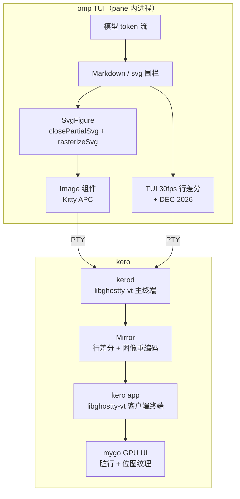

# kero 终端内图片渲染与流式输出调研

## 0. 调研范围与结论

- 调研对象：`egoist/kero`（原生 Go 终端应用）及其终端插件依赖 `egoist/mygo`。
- 截图中的运行内容：kero pane 内的 **omp（oh-my-pi）TUI**。图片、token 统计、提示符、底部 `#1 1524x838` 缩略图都由 omp 绘制，不是 kero 的聊天界面。
- 源码核对版本：
  - kero：`09eb1d42dfe24c8ffc07600024e152e096532519`（2026-11-10）
  - mygo：`90a1f06eb5c9e2c869c52d8d00cf0fa00f7c7962`（2026-11-10）
  - omp（can1357/oh-my-pi）：`1379127c078f978c9908059d31f6dc6c16efbe53`（2026-11-10）
  - 本机安装的 omp：`18.18.6`

### 核心结论

截图里的能力分成两层：

1. **图片显示**：不是 kero 认识模型输出，也不是 kero 解析 SVG。omp 把 Markdown 里的 `svg` 围栏栅格化成 PNG，通过 **Kitty graphics protocol** 写入 PTY；kero 嵌入的 **libghostty-vt** 解析协议，mygo 把图像当位图纹理绘制到终端网格上。
2. **流式渲染**：omp 自身以默认 30fps 做行差分 TUI；SVG 围栏在流式期间最多每 200ms 重栅格化一次，用完整快照替换上一张图。kero 的 daemon 再把 PTY 输出转换成脏行差分帧，客户端按显示刷新率重绘。终端层不会渲染半张图片。

一句话：**kero 提供终端协议与增量显示基础设施；真正把“模型输出”变成图片的是 omp 的 TUI 组件。**

---

## 1. 端到端架构



### 1.1 kero 不是“终端里的终端”，而是 daemon + 镜像终端

kero 的所有 session 都跑在 `kerod` 中，本地 session 也不例外。`app.go` 里对客户端终端有明确注释：

```go
// The terminal shows kerod's frames: kerod's terminal is the session's,
// ours shows what it shows, cell for cell, and lays out nothing of the
// program's own.
o.ResizeByConn = true
term, err := terminal.New(o)
```

对应源码：

- `internal/daemon/session.go:120`：daemon 用 `terminal.New(terminal.Options{Conn: &headless{...}})` 创建**唯一权威 emulator**。
- `internal/daemon/session.go:213`：PTY 输出通过 `s.term.Feed(p)` 喂给 libghostty-vt。
- `internal/daemon/session.go:782`：客户端 attach 时创建 `terminal.Mirror`。
- `internal/daemon/session.go:672`：`c.mirror.Frame()` 生成 VT 差分序列，通过 `FrameOutput` 发送。
- `app.go:625`：kero app attach 后创建一个 `Conn` 为流、`ResizeByConn=true` 的终端，只显示 daemon 的帧，不自己布局程序输出。

这个设计带来三个直接结果：

- session 在窗口关闭后继续存在；
- 本地与远程 host 走同一套显示路径；
- 图片作为终端状态的一部分被镜像，而不是依赖 SSH 端口转发原始图形数据。

---

## 2. 图片链路：Kitty graphics protocol

### 2.1 协议基础

终端不能直接显示 PNG。Kitty 协议使用 APC 序列：

```text
ESC _ G <params> ; <base64 payload> ESC \
```

关键参数：

| 参数 | 含义 |
|---|---|
| `a=t` | 只传输图像数据，不显示 |
| `a=p` | 放置已传输的图像 |
| `a=T` | 传输并显示 |
| `f=100` | PNG |
| `f=32` | 原始 RGBA |
| `o=z` | zlib 压缩 |
| `m=1/0` | 还有后续分块 / 最后一块 |
| `i=` | image id |
| `p=` | placement id |
| `c=`, `r=` | 占多少列、多少行 |
| `X=`, `Y=` | placement 在首单元格内的像素偏移 |
| `x=`, `y=`, `w=`, `h=` | 源图像子区域 |
| `U=1` | Unicode placeholder 虚拟放置 |
| `z=` | 图层：低于 `-2^30` 在背景后，负值在文字下，其余在文字上 |

### 2.2 omp 发送了什么

omp 的 `packages/tui/src/components/image.ts` 和 `packages/tui/src/terminal-capabilities.ts` 负责编码：

1. 传输图像数据（每个 image id 只发一次）：
   ```text
   a=t,f=100,q=2,i=<id>
   ```
   base64 PNG 每 4096 字符一段，首段 `m=1`，中间段 `m=1`，最后一段 `m=0`。

2. 放置图像：
   - 支持 Unicode placeholder 时：
     ```text
     a=p,U=1,q=2,i=<id>,p=<placement>,c=<cols>,r=<rows>
     ```
     后接由 `U+10EEEE` 组成的占位符网格；
   - 否则退回直接定位：
     ```text
     a=p,q=2,C=1,i=<id>,p=<placement>,c=<cols>,r=<rows>
     ```

3. 重绘时只重发 placement，不重发整张 PNG。placement 带稳定 `p=`，重复发送会替换原 placement，不会叠图。

### 2.3 kero 如何解析和绘制

`mygo/plugins/terminal` 里的图像链路：

1. **libghostty-vt 解析 APC**  
   `internal/vt/images.go` 绑定 `ghostty_kitty_graphics_*` C API；`SetImageLimit` 控制每个终端最多缓存多少图像字节，kero 默认 `320 << 20`（320 MiB）。

2. **PNG 解码钩子**  
   libghostty-vt 不内置 PNG 解码器。mygo 通过 `ghostty_sys` 注册 `decodePNG`，用 Go 的 `image/png` 解码，再把 RGBA 像素拷贝进库的内存。  
   因此 omp 的 `f=100` PNG 能被接收。mygo 侧限制：边长 ≤ 10000px，像素总量 ≤ 400MB。

3. **每个 generation 一张 bitmap**  
   `images.go:39 readImages()` 遍历当前屏幕的 placements；  
   `images.go:85 bitmap()` 用 `ImageGeneration(id)` 判断像素是否变化，只有变化时才 `decoded()` + `ui.NewBitmap()`；  
   图像数据未到齐时 generation 为 0，直接跳过。

4. **按 z 分层绘制**  
   `paint.go:511 draw()` 分三次调用 `drawImages()`：
   - `belowBackground`
   - `belowText`
   - `aboveText`

   每张图按 `placement.Col/Row + XOffset/YOffset` 定位，裁剪到终端网格，再通过 `ImageRegion()` 缩放绘制。

5. **图像缓存与失效**  
   `images.go` 用 `map[uint32]*cachedImage` 按 image id 缓存 bitmap；placement 消失后对应 bitmap 会被清理。Mirror 侧同样按 image id 记录 generation，只有新 generation 才重发像素。

### 2.4 Unicode placeholder：让图片参与文本网格

`placeholders.go` 识别 `U+10EEEE` 占位符单元格：

- 前景色 = image id；
- 下划线色 = placement id；
- combining mark = 行、列索引；
- 连续占位符会合并成 run，再根据虚拟 placement 的 `c/r` 计算源图子区域。

这样图片不是“浮在屏幕上的贴图”，而是参与文本网格的虚拟放置：滚动、裁剪、重排、水平切片都能取到正确的图像子区域。yazi 的预览、omp 的图片都走这条路径。

### 2.5 为什么 omp 知道要发 Kitty

`kerod` 给 pane 设置环境变量时做了关键的一步（`internal/daemon/daemon.go:539`）：

```go
set("TERM_PROGRAM=ghostty")
set("TERM_PROGRAM_VERSION=" + ghosttyVersion) // 1.3.2-dev
set("LC_TERMINAL=kero")
```

omp 的 `detectTerminalId()` 先看 `TERM_PROGRAM`，看到 `ghostty` 就选中：

```ts
ghostty: new TerminalInfo(
  "ghostty",
  ImageProtocol.Kitty,
  true,
  true,
  NotifyProtocol.Osc9,
  false,
  false,
  false,
  2,
)
```

并且 `detectKittyUnicodePlaceholdersSupport()` 对 `ghostty` 返回 true，所以 omp 直接走 Kitty + `U=1` placeholder，而不是 Sixel、iTerm2 或纯文本回退。

这是一个**有意的兼容性声明**：kero 使用 libghostty-vt，所以自称 Ghostty；好处是 agent 的 Kitty、通知、键盘协议等能力自动打开，代价是程序可能假设完整 Ghostty 的行为。

### 2.6 远程与本地镜像时图片怎么过

`kerod` 已经把图像解码成 RGBA，所以 Mirror 不是转发原始 PNG，而是重新编码（`mygo/plugins/terminal/mirror_images.go`）：

```text
a=t,f=32,o=z,s=<w>,v=<h>,i=<id>,q=2,m=1;<zlib(RGBA) base64>
...
a=p,i=<id>,p=<placement>,X=...,Y=...,x=...,y=...,w=...,h=...,c=...,r=...,z=...,C=1
```

即：

- zlib 压缩原始 RGBA；
- base64 每 4096 字符一段；
- 虚拟放置发送 `a=p,U=1,...`；
- 只在 image generation 变化时重发像素，普通重绘只发很小的 placement。

本地 session 走 Unix socket，也走同一条 Mirror 路径；远程 session 只是连接方式不同。

---

## 3. 流式渲染：两层节流

### 3.1 omp 侧：30fps 行差分 TUI

omp 的 TUI 本身就是一个差分渲染器：

- 默认帧率上限 **30fps**（`packages/tui/src/frame-rate.ts` 的 `DEFAULT_MAX_FPS = 30`）；
- 每帧只写变化的行；
- 支持的终端上用 **DEC 2026 synchronized output** 包住一帧，避免显示半帧；
- 有输出 backlog 时推迟渲染，避免把过期帧堆在 PTY 里。

### 3.2 omp 的 SVG 流式重栅格化

代码在 `packages/tui/src/chat/svg-figure.ts` 与 `svg-source.ts`：

1. `splitSvgFences()` 从流式 Markdown 中切出 `svg` 围栏；
2. 围栏还没结束时，`closePartialSvg()` 把半截 XML 修补成合法文档：
   - 丢掉还没写完的标签、注释、CDATA、实体引用；
   - 自动闭合未闭合元素；
   - 没有完整 `<svg ...>` 根标签时返回 null，先不画；
3. `rasterizeSvg()` 在 JS 线程之外异步栅格化成 PNG；
4. **流式期间最多每 200ms 栅格化一次，单飞**：
   ```ts
   const STREAM_INTERVAL_MS = 200;
   ```
5. 新栅格化完成前，旧图继续留在屏幕上；完成后替换 placement；
6. 围栏结束后取消节流，立即做最终栅格化；失败则回退成代码块。

视觉上像“恐龙一笔一笔画出来”，但终端层看到的是**每 200ms 一张完整的中间快照**。每次修订用新的 image id（`svg<id>:<revision>`），旧图在新图落地前不会被提前删掉，避免闪烁。

### 3.3 kero daemon 侧：4ms 合帧 + 行差分

`kerod` 收到 PTY 输出后：

1. 64KB 一块读取，立即 `s.term.Feed(p)`；
2. 标脏，`frameSoon()` 延迟 **4ms** 合帧：
   ```go
   const frameDelay = 4 * time.Millisecond
   ```
   源码注释：program's redraw comes in pieces。
3. `Mirror.Frame()` 读取 RenderState，按行内容/行 ID 做差分：
   - 没变的行不重发；
   - 滚动时只把滚出屏幕的行按顺序送出；
   - 光标、模式、颜色单独同步；
   - 遇到 DEC 2026 同步更新，最多等 1 秒，并每 50ms 重试。

### 3.4 kero app 侧：脏行重绘

kero app 收到帧后：

1. 喂给本地 libghostty-vt；
2. `write()` 请求重绘；
3. `paint()` 只重建 dirty 行：
   ```go
   if full || !line.ok || rs.RowDirty() {
       v.buildRow(line, rs, cols)
   }
   ```
4. 字形有 LRU 缓存，背景、下划线、盒线字符跨单元格合并；
5. 图像只在 generation 变化时重新解码/上传纹理；
6. 最终由 mygo 在显示器刷新节奏下合成到窗口。

因此 token 流不会触发整屏重绘，也不会每个 token 都刷一帧。

### 3.5 关键时间常量

| 层 | 机制 | 数值 |
|---|---|---|
| omp TUI | 默认帧率上限 | 30 fps |
| omp SvgFigure | 流式重栅格化间隔 | 200 ms |
| kerod | 输出合帧 | 4 ms |
| kerod Mirror | 同步更新重试 | 50 ms |
| libghostty/kero | DEC 2026 最长保持 | 1 s |
| kero | 每终端图像缓存 | 320 MiB |

---

## 4. 为什么终端不会显示“半张图”

Kitty 分块传输在 libghostty-vt 里是累积的：

1. 首块 `m=1` 创建 loading 状态；
2. 后续块继续追加；
3. 最后一块 `m=0` 到达后才解码 PNG（或接收 RGBA）、加入图像存储、分配 generation；
4. kero 的 `bitmap()` 只有看到非零 generation 且有完整像素时才创建 bitmap。

所以截图里的“渐进绘制”不是终端在解码半张 PNG，而是 omp 连续替换完整快照。同 id 重传时，Ghostty 在收到新传输第一块时就会删掉旧图和 placement；omp 的 SVG 流式修订故意每次用新 id，旧图才能在新图落地前保持可见。

---

## 5. 代价与边界

1. **远程图片带宽不低**  
   1524×838 的 RGBA 约 **5.1 MiB/帧**。omp 原发是 PNG，但 kerod 镜像时会重新编码成 zlib RGBA；如果流式期间每秒 5 次修订，远程链路要承受压缩后的持续图像流量。zlib 对大面积纯色很有效，但复杂图仍可能明显。

2. **kero 的这条链路是 Kitty-only**  
   mygo 的终端绘制代码里只有 Kitty graphics 分支，没有 Sixel/iTerm2 inline image 分支。程序如果只会发 Sixel，在 kero 里不会得到图片。

3. **`TERM_PROGRAM=ghostty` 是兼容性声明，不是完整 Ghostty**  
   kero 实际使用的是 libghostty-vt + 自绘 UI，不是 Ghostty 的 GPU renderer。大多数协议行为一致，但 agent 里针对 Ghostty 的特判也会被触发，例如 omp 对 Ghostty 首帧图片的 100ms 延迟。

4. **图像缓存有上限**  
   kero 每个终端默认 320 MiB；mygo 的 PNG 解码限制为单边 ≤ 10000px、总像素 ≤ 400MB。超过限制的图像会被拒绝，终端可能回退到文本或什么都不显示。

5. **kero 自称 Ghostty 的风险**  
   如果程序依赖完整 Ghostty 的某个特殊行为，而 libghostty-vt 或 mygo 没有实现，可能出现能力探测成功但实际行为不一致的问题。截图中的 omp 路径是兼容的，但不代表所有 Ghostty 特性都等价。

---

## 6. 代码索引

| 层 | 文件 | 作用 |
|---|---|---|
| kero 环境 | `internal/daemon/daemon.go:539` | `TERM_PROGRAM=ghostty` / `LC_TERMINAL=kero` |
| kero 主终端 | `internal/daemon/session.go:120` | `terminal.New` + headless PTY |
| kero 合帧 | `internal/daemon/session.go:648` | 4ms `frameDelay` |
| kero 镜像 | `internal/daemon/session.go:782` | `NewMirror` / 首帧 |
| kero 客户端 | `app.go:625` | attach 后创建镜像终端 |
| 帧读取 | `internal/client/client.go:338` | `FrameOutput` → `io.Reader` |
| 图像镜像 | `mygo/plugins/terminal/mirror_images.go:38` | `f=32,o=z` 重编码 + placement |
| PNG 解码 | `mygo/plugins/terminal/internal/vt/images.go:227` | 注册 Go PNG decoder |
| 图像读取 | `mygo/plugins/terminal/images.go:39` | placements → bitmap 缓存 |
| 图像绘制 | `mygo/plugins/terminal/images.go:121` | 分层、裁剪、缩放 |
| 占位符 | `mygo/plugins/terminal/placeholders.go:15` | `U+10EEEE` 虚拟放置 |
| 脏行绘制 | `mygo/plugins/terminal/paint.go:115` | RenderState + row cache |
| omp SVG | `packages/tui/src/chat/svg-figure.ts:308` | 200ms 单飞重栅格化 |
| omp 修补 | `packages/tui/src/chat/svg-source.ts:94` | `closePartialSvg` |
| omp Kitty | `packages/tui/src/terminal-capabilities.ts:900` | 4096 字符分块 |
| omp 检测 | `packages/tui/src/terminal-capabilities.ts:597` | ghostty → Kitty + placeholders |

---

## 7. 验证与证据边界

已核对：

- kero 的 daemon、Mirror、环境变量、客户端 attach 路径；
- mygo 的 libghostty-vt 绑定、PNG 解码钩子、图像缓存、placeholder 解析与绘制；
- omp 的终端能力检测、Kitty 编码、SVG 流式重栅格化逻辑；
- 仓库内测试：
  - mygo：`TestImagePNG`、`TestPlaceholders`、`TestMirrorPlaceholders`
  - omp：`draws the partial figure while its fence is still streaming`

未执行：

- 未启动 kero GUI 做端到端截图对比；
- 未实际测量远程链路下图片重编码的带宽与延迟。

因此本文的架构与代码路径结论来自源码阅读；具体帧率、压缩后体积和远程延迟属于运行时指标，需要在真实 session 上采样确认。
